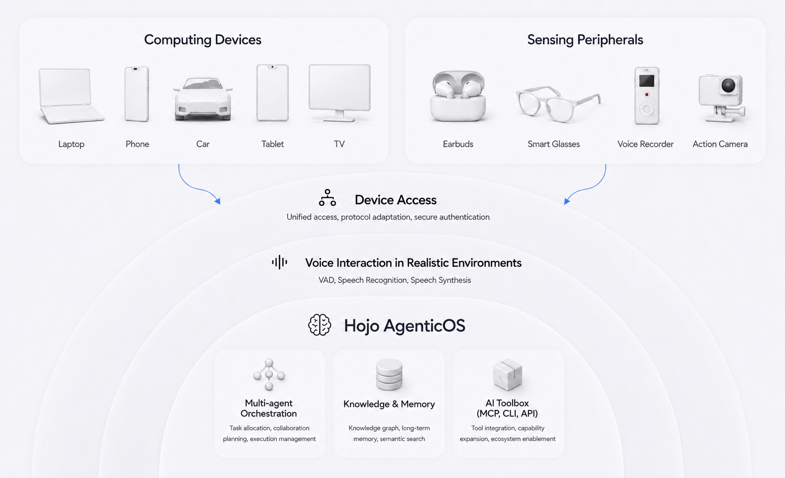

## Hojo AgenticOS - Holistic Omni Cross-Device Agentic Interaction System (Holistic Omni Cross-Device AgenticOS)

Hojo AgenticOS (full name Holistic Omni Joint Operator) is an open-source holistic, multimodal, cross-device agentic interaction system: it covers the full scenario domain through multi-agent collaborative orchestration (Holistic), supports voice, text, and streaming multimodality (Omni), and targets collaborative terminals such as earbuds, in-car systems, wearables, and smartphones (Joint Operator).

## Download Hojo

Experience Hojo on mobile and desktop. Choose your platform and service region.

| Platform | Hojo CN (Mainland China) | Hojo Global |
| :--- | :---: | :---: |
| **Android** | [Official Download][download-cn-android] | [Google Play][download-global-android] |
| **iOS** | [App Store][download-cn-ios] | [App Store][download-global-ios] |
| **macOS** | [Download][download-cn-macos] | [Download][download-global-macos] |
| **Windows** | [Download][download-cn-windows] | [Download][download-global-windows] |

## Industry Status

- High barriers to AI integration for hardware: Hardware AI-native development lags far behind software. Most hardware has not yet entered the AI-native era. LLM companies often provide only general SDKs or APIs, while creating truly seamless hardware-integrated experiences requires extensive complex work.
- Fragmented multi-device usage and lack of interconnected ecosystems: Users utilize various brands of devices, but there is no unified standard for AI access. Data and scenarios are disconnected, leading to low productivity and an inability to form full-scenario synergy.
- High learning curve for AI products: Users lack easy-to-use AI products that don't require complex configurations or command-line interfaces (not everyone can configure OpenClaw or Hermes Agent).
- Incomplete user data privacy mechanisms: There is a need for a highly available, reliable AI product that protects user privacy while allowing access across multiple interactive devices for "anywhere, anytime" interaction.

## Our Outlook and Perspective

We believe humanity is rapidly transitioning from the mobile internet era to the Agent Era. What we believe in the future:

- Everyone will need an Agent that serves them exclusively. This Agent will not represent a specific company, but the individual. In the future, there won't be a single "one-size-fits-all" giant or a unified AI Agent for everyone; instead, everyone will have their own.
- This Personal Agent will be like a trusted partner—remembering us like a real person, gaining insight into our needs, and proactively offering help. It is always online, can collaborate with us, and communicate through the nearest device while remaining context-aware. Just as a person can communicate face-to-face, via phone, IM, or email, you always know that "person" is the same person.

Therefore, we believe a Personal Agent needs several key characteristics, which are also our core design philosophies:

- **Human** - Human-like interaction capabilities, including voice and visual multi-modal interaction.
- **Proactive** - Capable of intuiting human needs and serving proactively.
- **Attentive** - Always online, capable of collaborating with humans across multiple devices.
- **Reliable** - High availability, high stability, and protection of user data privacy.
- **Inclusive** - Open and compatible; easy to connect to various devices and services, call upon various user tools, and be called upon, allowing data and information to flow seamlessly.

---

## Table of Contents

- [Download Hojo](#downloads)
- [Positioning and Capabilities](#positioning-and-capabilities)
- [Why Open Source This Repository](#why-open-source-this-repository)
- [Enterprise Users and Typical Scenarios](#enterprise-users-and-typical-scenarios)
- [What You Can Get](#what-you-can-get)
- [Quick Start](#quick-start)
- [Architecture and Components](#architecture-and-components)
- [Build and Dependency Instructions](#build-and-dependency-instructions)
- [Tech Stack](#tech-stack)
- [License](#license)
- [Contribution](#contribution)
- [Coming Soon](#coming-soon)
- [FAQ](#faq)
- [Documentation and Community](#documentation-and-community)
- [Trademarks and Business Cooperation](#trademarks-and-business-cooperation)

---

## Positioning and Capabilities

### Industrial-Grade AgenticOS (Server-side)

Hojo AgenticOS is a multi-agent interaction system that supports smart hardware integration. It features multi-modal voice interaction, multi-agent scheduling, and user memory. It is pre-configured with agents for productivity scenarios like translation, meetings, scheduling, music, and weather.

**Capability Boundaries:**
In the early stages, we believe AI is most significant for productivity enhancement among knowledge workers. Therefore, our priority is on high-density information tasks, such as personal knowledge/affair management and personalized infotainment. Our preferred devices are those capable of direct human interaction with voice input/output (computing devices like phones, PCs, pads, car systems, TVs, and voice devices like earbuds, speakers, and recorders), rather than smart home control devices.

| Dimension | This Repository IS | This Repository IS NOT |
| ---- | ---- | ---- |
| Target Developer | Enterprise integrators, hardware manufacturers, OEM/ODM, car/wearable teams | General individual users, C-end consumers |
| Delivery form | Microservices backend, gateway, orchestration, multi-agent scheduling | Complete front-end App, app store installer, device firmware |
| Deployment | Supports private cloud, VPC, Docker full-stack deployment | Ready-to-use SaaS, official hosted service |
| Threshold | Suitable for B-end teams with R&D/integration capabilities | Consumer products usable without technical background |
| Core value | Lower the cost for enterprises to develop their own Agentic interaction systems | Personal entertainment/chat tool |

---

## Why Open Source This Repository

We believe that in the future, everyone will have their own Personal Agent that connects all the services they need and their hardware devices across different brands to provide a highly personalized experience. Currently, major hardware platforms open their protocols for IoT-related peripheral hardware, but only for control-type devices (e.g., switches, AC, curtains, lights and other smart home devices); there is almost no support for high-density information transmission and productivity. By open-sourcing AgenticOS, we hope to provide a unified Agent access protocol, scheduling rules, and development standards for every hardware manufacturer—allowing devices from different brands (like earbuds and cameras) to work together on a single task.

## Enterprise Users and Typical Scenarios

**Who is it for:** Smart hardware development teams (earbuds, Car systems, Wearables, Phones, OEM/ODM), platform teams, and backend engineers. Individual developers can also self-host for learning and secondary development.

**Best-fit, Fastest Integration Users:** Platform teams, solution architects, and backend engineers in **enterprises and suppliers** (including OEM/ODM, Automotive, Carriers, SaaS ISVs, large IT departments) who need to run a **governable multi-agent voice assistant stack** on their own infrastructure. **Individual developers** can use the same code path for personal assistants or experiments; however, they may need to assemble their own client-side components, credentials, and O&M compared to the standardized B-end path.

**Typical Scenarios (Non-exhaustive):**

| Scenario | Value Provided by This Repository |
|------|-------------------|
| **Private / VPC Deployment** | Run full-stack or subsets on your own cloud; replace model endpoints and keys via config. |
| **OEM / Device Cloud Backend** | Use gateway + orchestration as the **control plane** behind brand Apps or embedded Agents; integrate self-owned ASR/TTS/Device SDKs at the edge. |
| **Automotive / Travel Assistant** | Reference the "Voice Gateway + Business Gateway" multi-terminal synergy model for cockpit and mobile companion architecture validation. |
| **Enterprise "Assistant Middle-end"** | Consolidate accounts, sessions, and routing; extend vertical domains using templates for meetings, schedules, translation, weather, music, etc. |
| **ISV Industry Packaging** | Fork or extend scenario services on top of a stable orchestration contract (`hojoai-routing-engine-contract`). |
| **R&D and Selection Evaluation** | Evaluate session reuse, multi-agent handoff, and latency performance before self-developing. |

---

**Design Preferences in This Code:**

- **Realistic Voice Environment**: Supports interruptions, continuations, and multi-terminal handoffs, rather than just text polling.
- **Distinguishable Device Roles**: earbuds, phones, cars, and watches act as collaborative participants rather than just a single-screen chatbot.
- **Extensible Scenario Agents**: Add, remove, or replace vertical capabilities without majorly restructuring the skeleton.

The consumer-facing hardware/app roadmap is independent of this **Server Community Edition**.

---

## What You Can Get (Capabilities and Characteristics We Believe AgenticOS Should Have)

**Capabilities ready to use as a reference implementation:**

- **Hardware Access Layer**: Provides faster efficiency and a consistent experience for users. The same Agentic system capabilities can be deployed to multiple devices. As an independent backend system, it defines standard protocols for rapid smart hardware integration.
- **Intelligent Orchestration Layer**: Upgrades from "able to chat" to "able to drive tasks to completion"; from "dialogue" to "execution." Less talk, less rework—more efficient and worry-free for users. Supports dynamic discovery and expansion of new skills during execution; supports intelligent task decomposition and planning as a dynamic workflow based on feedback.
- **Multi-Agent Tool Layer**: A single entry point for high-frequency life and work scenarios. Users don't need to jump between dozens of apps. Using voice or dialogue, users can complete daily tasks like searching for info, organizing content, meetings, minutes, reminders, and real-time translation.
- **Knowledge Memory Layer**: Constructs a private memory warehouse for each user, remembering behaviors and events, and proactively initiating actions to solve problems. Users feel recognized and understood, lowering communication costs.
- **Natural Conversation Layer**: Once hardware is connected to Hojo AgenticOS, it supports voice dialogue and RTC dialogue, with future support for full multimodal interactions including vision.

 

## Quick Start

**How to use:** Clone the repo → Build according to docs (Docker local full-stack) → Integrate your own client and device SDKs → Replace models and keys to go live.
**Note:** This repository is a **Server Reference Implementation**. It does not include a consumer-ready App or device firmware. Clients, key management, and production-grade SRE are the responsibility of the integrator. Supports earbuds, cars, wearables, and phones; embedded devices in pure offline environments need to evaluate network connectivity requirements.

Shortest path: Clone → copy **`.env.example` to `.env`** and set passwords → build per **[docs/BUILD.md](docs/BUILD.md)** → `docker compose`. Ports, infra, and validation: **[docs/QUICK_START.md](docs/QUICK_START.md)**. Maven uses the root **aggregate `pom.xml`**, documented in **[docs/BUILD.md](docs/BUILD.md)**.

**3-Step Navigation:**

1. Clone the repository and work in the root directory.
2. Execute Maven builds in the order specified in [docs/BUILD.md](docs/BUILD.md) (or use `make build` from the provided `Makefile`).
3. Complete configuration, startup, and health checks according to [docs/QUICK_START.md](docs/QUICK_START.md) (Docker Compose; **Nacos 3.x** console defaults to the root path **`http://127.0.0.1:8080/`**, do not use the 2.x `/nacos` suffix).

**Deep Links:** [In-doc Table of Contents](docs/QUICK_START.md#quickstart-toc) · [Port Conventions `11xxx` / `12xxx`](docs/QUICK_START.md#quickstart-ports) · [Docker Infrastructure](docs/QUICK_START.md#quickstart-infra-docker) · [Full Stack Example](docs/QUICK_START.md#quickstart-full-stack) · [Architecture Details](docs/ARCHITECTURE.md)

---

## Architecture and Components

Clients enter the system through the **Business Gateway** and **Voice Gateway**. Requests are routed to scenario services and middle-end components. **ProtocolGuard** on the outer ring is **under planning** for unified access governance (Auth, Schema/State machine, compatibility matrix, anti-replay)—**current live traffic** still relies on the two gateways and existing account/auth capabilities.

**Component default ports** are from module `application.properties`; please adjust during deployment based on [Port Conventions](docs/QUICK_START.md#quickstart-ports).

| Running Unit | Default Port | Role | Documentation |
|---------|---------|------|------|
| `hojoai-gateway-omniasst` | 12001 | **Business Entry**: HTTP + WebSocket | [README](hojoai-gateway-omniasst/README.md) · [API](hojoai-gateway-omniasst/API.md) |
| `hojoai-gateway-omniasst-voice` | 12002 | **Voice Entry**: ASR/TTS/NLU & Stream Proxy | [README](hojoai-gateway-omniasst-voice/README.md) · [API](hojoai-gateway-omniasst-voice/API.md) |
| `hojoai-gateway-central` | 11001 | **Central Domain / Ops** Gateway | [README](hojoai-gateway-central/README.md) · [API](hojoai-gateway-central/API.md) |
| `hojoai-websocket-omniasst-sysagent` | 12003 | **Orchestration Hub**: Stream dialogue, Intent routing, Device orchestration | [README](hojoai-websocket-omniasst-sysagent/README.md) · [API](hojoai-websocket-omniasst-sysagent/API.md) |
| `hojoai-webmvc-omniasst-account` | 12004 | **User Identity & Auth** | [README](hojoai-webmvc-omniasst-account/README.md) · [API](hojoai-webmvc-omniasst-account/API.md) |
| `hojoai-webmvc-omniasst-management` | 12005 | **Session & Message Middle-end** | [README](hojoai-webmvc-omniasst-management/README.md) · [API](hojoai-webmvc-omniasst-management/API.md) |
| `hojoai-webmvc-omniasst-translate` | 12006 | **Translation Agent** | [README](hojoai-webmvc-omniasst-translate/README.md) · [API](hojoai-webmvc-omniasst-translate/API.md) |
| `hojoai-webmvc-omniasst-meeting` | 12007 | **Meeting Agent** (Real-time transcription) | [README](hojoai-webmvc-omniasst-meeting/README.md) · [API](hojoai-webmvc-omniasst-meeting/API.md) |
| `hojoai-webmvc-omniasst-focus` | 12008 | **Schedule Agent** | [README](hojoai-webmvc-omniasst-focus/README.md) · [API](hojoai-webmvc-omniasst-focus/API.md) |
| `hojoai-webmvc-omniasst-music` | 12009 | **Music Agent** | [README](hojoai-webmvc-omniasst-music/README.md) · [API](hojoai-webmvc-omniasst-music/API.md) |
| `hojoai-webmvc-omniasst-weather` | 12010 | **Weather Agent** | [README](hojoai-webmvc-omniasst-weather/README.md) · [API](hojoai-webmvc-omniasst-weather/API.md) |
| `hojoai-webmvc-omniasst-headphone` | 12011 | **Headphone Device Agent** (**the root `docker-compose.yml` does not include this service**; run locally via `mvn`/IDE or your own image) | [README](hojoai-webmvc-omniasst-headphone/README.md) |
| `hojoai-webmvc-central-account` | 11002 | Central Domain **Account REST** | [README](hojoai-webmvc-central-account/README.md) · [API](hojoai-webmvc-central-account/API.md) |
| `hojoai-grpc-central-provider` (server sub) | 11003 / 11103 | **gRPC** Middle-end capabilities | [README](hojoai-grpc-central-provider/README.md) · [API](hojoai-grpc-central-provider/API.md) |

**Libraries & Scaffolding** (Cannot run independently): `hojoai-common` · `hojoai-omniasst-common` · `hojoai-grpc-central-provider-api` · `hojoai-routing-engine-contract` · `hojoai-parent` · `hojoai-template`

Detailed architecture, headphone agent (`headphoneMode`), and protocol goals can be found in the [Architecture Document](docs/ARCHITECTURE.md).

---

## Build and Dependency Instructions

Runtime routing, Feign targets, and gateway rules are **not repeated here**; see source code, `application-dev.properties`, and [hojoai-gateway-omniasst/API.md](hojoai-gateway-omniasst/API.md). The **full repository build order** is in [docs/BUILD.md](docs/BUILD.md). Currently, the open-source tree **does not require** a private Maven repository to build.

**Shared libraries that runnable services may depend on (besides `hojoai-common`):**

| Shared Library | Usage |
|--------|------|
| `hojoai-grpc-central-provider-api` | gRPC client stubs and contracts |
| `hojoai-omniasst-common` | Omniasst domain shared types and clients |
| `hojoai-routing-engine-contract` | Orchestration SPI and routing DTOs |

**Summary by Service (Selection):**

| Extra Dependencies | Sub-module |
|----------|--------|
| `hojoai-grpc-central-provider-api` | `hojoai-grpc-central-provider-server` |
| `hojoai-grpc-central-provider-api`, `hojoai-omniasst-common`, `hojoai-routing-engine-contract` | `hojoai-websocket-omniasst-sysagent-server` |
| `hojoai-grpc-central-provider-api`, `hojoai-omniasst-common` | `hojoai-webmvc-omniasst-management-server`, `hojoai-webmvc-omniasst-focus-server` |
| `hojoai-omniasst-common` | `hojoai-webmvc-omniasst-translate-server`, `hojoai-webmvc-omniasst-meeting-server` |
| (None besides common) | Gateways, central-account, omniasst-account, music, weather, etc. |

Versions are managed globally by the parent BOM **[hojoai-parent/pom.xml](hojoai-parent/pom.xml)**.

---

## Tech Stack

Java **21**; recognizing that most hardware manufacturers choose Java for backend development, we respect this choice and use Java as the primary language for this industrial-grade project.

Version details: Spring Boot / Spring Cloud versions are based on [hojoai-parent/pom.xml](hojoai-parent/pom.xml). Common components include **Nacos**, **Spring Cloud Gateway**, **MySQL**, **Redis**, **PostgreSQL**, **OpenFeign**, etc. Voice and real-time communication may involve **Microsoft Cognitive Services Speech SDK** and **DingTalk RTC Linux Java SDK**—license and distribution requirements can be found in [THIRD_PARTY_NOTICES.md](docs/THIRD_PARTY_NOTICES.md) and [License](#license).

---

## License

### Project License

This project is licensed under the **Modified Apache License 2.0**, meaning the **Apache License, Version 2.0** with additional terms, including branding integrity, attribution retention, and contributor-related terms. The full scope of rights and restrictions is governed by the root [LICENSE](LICENSE).

Please note that this project is not licensed under the standard Apache License 2.0. Do not interpret the scope of rights solely based on a badge or the phrase "Apache 2.0".

### Key Differences from Standard Apache-2.0

- **Brand Integrity**: You must retain the identifiers and requirements used to indicate support by **Hojo AgenticOS**, including `X-Powered-By` = `Hojo AgenticOS`, `powered_by` = `Hojo AgenticOS` (and equivalent fields).
- **Attribution Information**: You must retain the brand/attribution statements provided by the Licensor (e.g., Headers, metadata, NOTICE, build manifests). Unauthorized removal or modification is prohibited.
- **Contributor Terms**: As a contributor, you agree that the producer may adjust this open-source agreement to be more strict or more permissive as deemed necessary, and that your contributed code may be used for commercial purposes, including but not limited to cloud business or hosted service operations.
- **Consequences of Breach**: Unauthorized removal or modification of restricted content may constitute a breach of license. For commercial and branding cooperation, please contact `bd@hojoai.com`.

### Third-Party SDKs and Cloud Services

Adapter code within the repository may introduce non-Apache-2.0 SDKs or cloud service dependencies. Please comply with each vendor's terms; see [THIRD_PARTY_NOTICES.md](docs/THIRD_PARTY_NOTICES.md) for details.

---

## Contribution

Workflow and specifications are in [CONTRIBUTING.md](CONTRIBUTING.md). **Security Vulnerabilities**: Please do not discuss exploitable details in public Issues; report privately via [SECURITY.md](SECURITY.md).

---

## 🚀 Coming Soon

| Time |  |
|------|--------|
| **May 2026** | Personal Long-term Memory |
| **June 2026** | Personal Knowledge Management |
| **June 2026** | Personal Cloud Space |
| **June 2026** | Proactive Interaction |
| **June 2026** | Full-Duplex Voice Dialogue |
| **June 2026** | Companion Mobile Apps (iOS/Android) and Desktop Apps (macOS/Windows) |
| **July 2026** | Hardware Integration: Recording and Camera Devices |

Feature proposals for this open-source repository are tracked via [New Feature Proposal](https://github.com/HojoAI/Hojo-AgenticOS/issues/new?template=feature_request.yml); scheduling is based on Maintainer updates in Issues.

---

## FAQ

**Is this a complete product for end-users?**
No—it is a **Server Reference Implementation**. You need to integrate the client, device, and O&M systems. **Individuals/Enthusiasts** can still self-host for learning; **B-end teams** can use the documentation and service modularity to move quickly toward production-ready integration.

**Do I have to start all services at once?**
Not necessarily. A common path is to start **Nacos + Gateways + SysAgent + management + account** first, then enable scenario Agents as needed. See [QUICK_START.md](docs/QUICK_START.md).

**Can I replace LLM / ASR / TTS providers?**
Yes, depending on the configuration and adapter layer of each module. Keys, quotas, and data residency are your responsibility.

**What is the relationship with HojoAI Cloud Hosted Services?**
This repository is the **Community Edition Server**. Feature alignment, SLA, and enterprise value-add packages may differ. For commercial solutions, please contact `bd@hojoai.com`.

**Who is responsible for security and compliance?**
Network isolation, key rotation, audit logs, and compliance with local regulations must be completed by the user. The **ProtocolGuard** unified access governance is a **roadmap capability** and does not equate to out-of-the-box compliance certification.

**How do I add a new Agent?**
Implement an independent service and expose a clear API, integrate it via the existing gateway routing mode, and align with the orchestration contract in `hojoai-routing-engine-contract`. See module READMEs and [ARCHITECTURE.md](docs/ARCHITECTURE.md).

**Why is it Apache-2.0 "plus terms"?**
See [License](#license): In addition to Apache-2.0, there are specific branding and attribution constraints.

---

## Documentation and Community

- **By Module**: Each directory's `README` / `API`; see [Architecture and Components](#architecture-and-components) for the index.
- **Routing Overview**: [hojoai-gateway-omniasst/API.md](hojoai-gateway-omniasst/API.md).
- **Exchange & Troubleshooting**: [GitHub Issues](https://github.com/HojoAI/Hojo-AgenticOS/issues) · [GitHub Discussions](https://github.com/HojoAI/Hojo-AgenticOS/discussions).
- **Compliance & Collaboration**: [TRADEMARK.md](docs/TRADEMARK.md), [THIRD_PARTY_NOTICES.md](docs/THIRD_PARTY_NOTICES.md), [CONTRIBUTING.md](CONTRIBUTING.md), [CODE_OF_CONDUCT.md](CODE_OF_CONDUCT.md), [SECURITY.md](SECURITY.md).

---

## Trademarks and Business Cooperation

**Trademarks / Brand Logos**: **Hojo**, **Hojo.ai**, as well as the **Hojo** trademark and related **Logos**. We encourage integration and commercial use within the scope of the open-source license. Please prominently state in your product or service that the technology is powered by **Hojo**. Do not use the **Hojo** name to mislead or imply unauthorized official endorsement. Details can be found in [TRADEMARK.md](docs/TRADEMARK.md).

For Enterprise edition (stronger server capabilities, client features, and custom development), please contact `bd@hojoai.com`.

[download-cn-android]: https://www.hojoai.com/share/download?environment=domestic&lang=en-US
[download-cn-ios]: https://apps.apple.com/app/id6773312722
[download-cn-macos]: https://cdn.hojoai.com/download/apks/Hojo-domestic-release-1.3.0.dmg
[download-cn-windows]: https://cdn.hojoai.com/download/apks/Hojo-domestic-release-setup-1.3.0.exe
[download-global-android]: https://www.hojoai.com/share/download?environment=oversea&lang=en-US
[download-global-ios]: https://apps.apple.com/app/id6760108275
[download-global-macos]: https://cdn.hojoai.com/download/apks/Hojo-overseas-release-1.3.0.dmg
[download-global-windows]: https://cdn.hojoai.com/download/apks/Hojo-overseas-release-setup-1.3.0.exe
