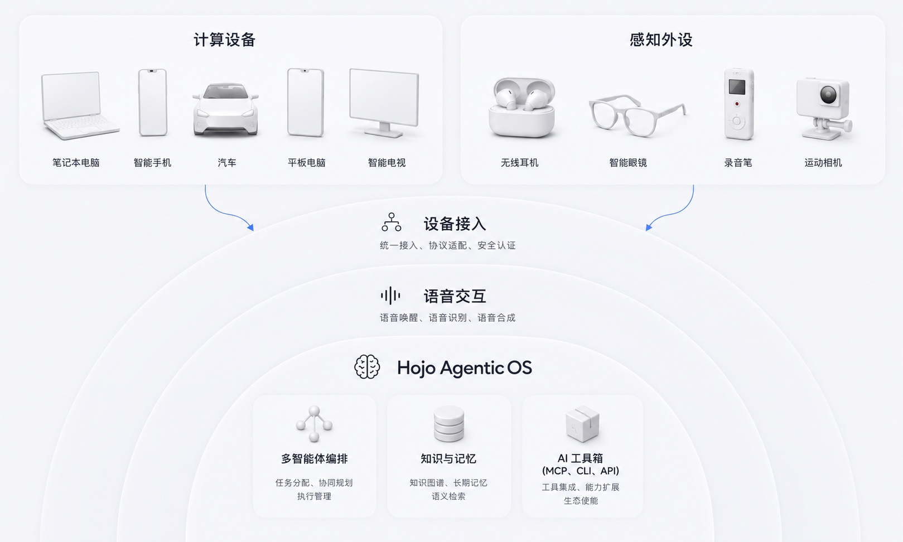

## Hojo AgenticOS - 全域全模态跨设备智能体交互系统（Holistic Omni Cross-Device AgenticOS）

Hojo AgenticOS（全称Holistic Omni Joint Operator）是开源的全域、全模态、跨设备智能体交互系统：以多智能体协同编排覆盖完整场景域（Holistic），支持语音、文本与流式多模态（Omni），并面向耳机、车机、穿戴与手机等协同终端（Joint Operator）。

## 下载 Hojo

在手机与电脑上体验 Hojo，选择适合你的设备与服务地区。

| 平台 | Hojo CN （中国大陆版） | Hojo Global （国际版） |
| :--- | :---: | :---: |
| **Android** | [官方下载][download-cn-android] | [Google Play][download-global-android] |
| **iOS** | [App Store][download-cn-ios] | [App Store][download-global-ios] |
| **macOS** | [下载][download-cn-macos] | [下载][download-global-macos] |
| **Windows** | [下载][download-cn-windows] | [下载][download-global-windows] |

## 行业现状
- 智能硬件接入AI能力门槛高：硬件AI化远落后于软件，大多数硬件仍未迈入AI-native时代。大模型公司往往仅提供通用SDK或API，真正落到硬件产生用户体验良好的交互需要大量复杂工作
- 多设备单点使用问题，无法构建互联互通的使用场景以及数据体系：用户使用各种品牌的设备，多设备AI接入无统一标准，数据和场景无法连通，生产力低下，无法形成全场景联动
- AI产品存在较高学习成本：用户缺少非常易用，不需要一堆配置和命令行的AI产品，并非人人都会配置OpenClaw和Hermes Agent
- 用户数据隐私机制不完善：一个高可用性，高度可靠，且能保护用户隐私的AI产品，并且能够接入多个交互设备，让AI随处可交互，随时可交互

## 我们对未来的展望和判断

我们认为人类即将从移动互联网时代快速进入到Agent时代，我们对未来有一些自己的判断：

- 每个人都需要一个完全服务于自己的Agent，这个Agent背后不代表某个公司，而是代表个人。未来不会出现一个通吃型巨头，或统一的AI Agent为所有人服务，而是每个人都有一个。
- 这个Personal Agent就像一个我们信赖的伙伴，可以像真人一样记得我们，洞察我们的需求，主动为我们提供帮助，他时刻在线，可以跟我们协同工作，也可以通过就近的设备与您随时沟通，并且能感知到场景和上下文。就像一个真人可以通过面对面、电话、IM和email跟您沟通一样，我们都知道背后那个人就是我们认识的那个人。

因此，我们认为Personal Agent需要具备几个关键特性，这也是我们的设计思想：

- **Human** - 真人般的交互能力，包括语音、视觉的多模态交互能力
- **Proactive** - 能够洞察人的需求并主动为人服务
- **Attentive** - 时刻在线，可通过多设备与人一起协同工作
- **Reliable** - 高可用性，高稳定性，保护用户的数据隐私
- **Inclusive** - 开放兼容，可以方便接入各种设备、连接各种服务，调用用户的各种工具，并且可以被调用，数据和信息可以无缝流转

---

## 目录

- [下载 Hojo](#downloads)
- [定位与能力边界](#定位与能力边界)
- [为何开源本仓库](#为何开源本仓库)
- [企业级用户与典型场景](#企业级用户与典型场景)
- [你能获得什么](#你能获得什么)
- [快速开始](#快速开始)
- [架构与组件](#架构与组件)
- [构建与依赖说明](#构建与依赖说明)
- [技术栈](#技术栈)
- [许可证](#许可证)
- [贡献](#贡献)
- [路线图](#路线图)
- [常见问题](#常见问题)
- [文档与社区](#文档与社区)
- [商标与商业合作](#商标与商业合作)

---

## 定位与能力边界

### 工业级AgenticOS（服务端）
Hojo AgenticOS——支持接入智能硬件的多智能体交互系统，具备多模态语音交互、多智能体调度、用户记忆等能力，面向生产力场景同步配置了翻译、会议、日程、音乐、天气等智能体

**能力边界：**
在项目初期，我们认为AI在知识工作者的生产力提升方面有非常重要的意义，所以我们的优先级会放在高信息密度的任务处理，如个人知识及事务管理、个性化的信息娱乐等方面，首选可以直接跟人交互，具备语音输入输出类的设备（手机、电脑、Pad、车机、电视等算力设备，及耳机、音箱、录音类语音设备），而非智能家居型的控制型设备。

| 维度 | 本仓库是 | 本仓库不是 |
| ---- | ---- | ---- |
| 核心受众 | 企业集成方、硬件厂商、OEM/ODM、车机 / 穿戴团队 | 普通个人用户、C端消费者 |
| 交付形态 | 微服务架构后端、网关、编排、多Agent调度 | 完整前端App、应用商店安装包、设备固件 |
| 部署方式 | 支持私有化、VPC、Docker全栈部署 | 开箱即用SaaS、官方托管服务 |
| 使用门槛 | 适合有研发 / 集成能力的B端团队 | 无技术背景即可使用的消费产品 |
| 核心价值 | 降低企业自研智能体交互系统成本 | 面向个人的娱乐 / 聊天工具 |

---

## 为何开源本仓库

我们相信未来每个人都会有一个自己专属的Personal Agent，可以连接所有用户需要的服务和自己各个品牌的硬件设备，为用户提供高度个性化的专属体验。而现有的现状是一些硬件平台大厂开放协议为一些IoT之类的附属硬件提供接入能力，但仅是一些控制类的设备（例如开关、空调、窗帘、电灯等智能家居设备），而高信息密度的信息传递和生产力提升几乎没有，我们希望开源AgenticOS的能力，可以为每一个硬件厂商提供统一的Agent接入协议，调度规则与开发标准，哪怕不同品牌的设备，比如不同品牌的耳机和摄像头，可以同时为用户在一个任务下协同工作。

## 企业级用户与典型场景

**谁适合用：** 智能硬件开发团队（耳机、车机、穿戴设备、手机等 OEM/ODM 厂商）、平台团队与服务端工程师；个人开发者也可自托管学习和二次开发。

**最契合、接入最快的使用者：** 需要在自己基础设施上运行**可治理的多智能体语音助手栈**的**企业与供应商**中的平台团队、解决方案架构师与服务端工程师（含 OEM/ODM、汽车、运营商、SaaS ISV、大型信息化部门等）。**个人开发者**做自用助手或实验亦可走同一套代码路径；相对 B 端标准化路径，在客户端、凭证与运维上往往需要更多自行拼装。

**典型场景（示例，非穷举）：**

| 场景 | 本仓库能提供的价值 |
|------|-------------------|
| **私有化 / VPC 部署** | 在自有云上运行全栈或子集；通过配置替换模型地址与密钥。 |
| **OEM / 设备云服务端** | 将网关 + 编排作为品牌 App 或嵌入式 Agent 背后的**控制面**；在边缘对接自有 ASR/TTS/设备 SDK。 |
| **车载 / 出行助手** | 参考「语音网关 + 业务网关」多端协同模式，用于座舱与手机伴侣协同等架构验证。 |
| **企业「助手中台」** | 收敛账户、会话与路由；以会议、日程、翻译、天气、音乐等 Agent 为模板扩展自有垂直域。 |
| **ISV 行业封装** | 在稳定编排契约（`hojoai-routing-engine-contract`）之上 fork 或扩展场景服务。 |
| **研发与选型评估** | 在自研前评估会话复用、多 Agent 接力与延迟表现。 |

---

**在本代码中的设计取向：**

- **贴近真实环境的语音**：打断、续接、多端接力，而非仅文本轮询。
- **设备角色可区分**：耳机、手机、车机、手表等作为协同参与者，而非单屏聊天机器人。
- **场景 Agent 可扩展**：在不大改骨架的前提下增删或替换垂直能力。

面向消费者的硬件 / App 路线图与**本服务端社区版**相互独立。

---

## 你能获得什么（我们认为的AgenticOS需要具备什么样的能力和特征）

**作为参考实现可直接启用的能力：**

- **硬件接入层**: 为使用者提供更快使用效率、更一致使用体验，同一套智能体交互系统能力可以铺到多款设备，作为独立服务端系统，定义标准快速接入智能硬件
- **智能调度层**：从「能聊天」升级到「能把事情推进到结果」，从「对话」升级到「办事」；少废话，少返工，用户使用更高效、更省心。在执行任务中，支持自主动态发现新技能，动态扩展技能；同时支持智能调度，基于用户指令完成任务拆解，在执行过程中拆解分析任务，将任务规划为动态workflow，在执行过程中收集子任务反馈，并动态调整workflow
- **多智能体工具层**：一个入口解决高频生活与工作场景，用户不必在十几个App或者多个工具之间反复跳转。在统一体验下，用户直接用语音或对话完成日常事务，例如找资料、整理内容、开会、会议纪要、日程提醒、实时翻译等能力
- **知识记忆层**：为每个用户构造私域记忆仓库，记住用户的行为、事件，主动发起事件，帮助用户解决问题；用户可以感觉被认出来、被懂，不用重复解释，表达成本低，沟通以及解决问题效率高
- **自然对话交互层**：硬件设备接入Hojo AgenticOS之后，支持语音对话、RTC对话，后续支持包括视觉等全模态交互

 

## 快速开始

**怎么用：** 克隆仓库 → 按文档顺序构建（Docker 本地全栈）→ 对接自有客户端与设备侧 SDK → 替换模型与密钥即可上线生产。
**注意：** 本仓库为**服务端参考实现**，不附带消费者App成品或设备固件，客户端、密钥管理与生产级SRE由集成方负责。支持耳机、车机、穿戴与手机等协同终端接入；纯离线或无网络环境的嵌入式设备需自行评估网络连通性要求。

最短路径：克隆 → 复制 **`.env.example` 为 `.env`** 并修改口令 → 按 **[docs/BUILD_zh.md](docs/BUILD_zh.md)** 构建 → `docker compose`。端口、基础设施与验证命令：**[docs/QUICK_START_zh.md](docs/QUICK_START_zh.md)**。Maven 使用仓库根 **聚合 `pom.xml`** 与 **[docs/BUILD_zh.md](docs/BUILD_zh.md)** 说明一致。

**三步导航：**

1. 克隆本仓库并在仓库根目录工作。  
2. 按 [docs/BUILD_zh.md](docs/BUILD_zh.md) 顺序执行 Maven 构建（或使用仓库提供的 `Makefile` 中的 `make build`）。  
3. 按 [docs/QUICK_START_zh.md](docs/QUICK_START_zh.md) 完成配置、启动与健康检查（Docker Compose；**Nacos 3.x** 控制台默认 **`http://127.0.0.1:8080/`** 根路径，勿沿用 2.x 的 `/nacos` 写法）。

**文档深链：** [文内目录](docs/QUICK_START_zh.md#quickstart-toc) · [端口约定 `11xxx` / `12xxx`](docs/QUICK_START_zh.md#quickstart-ports) · [Docker 基础设施](docs/QUICK_START_zh.md#quickstart-infra-docker) · [全栈示例](docs/QUICK_START_zh.md#quickstart-full-stack) · [架构说明](docs/ARCHITECTURE_zh.md)

---

## 架构与组件

客户端通过**业务网关**与**语音网关**进入系统，请求经路由分发至场景服务与中台组件。架构图最外圈的 **ProtocolGuard** 为**规划中**的统一接入治理（鉴权、Schema/状态机、兼容矩阵、防重放）——**当前现网流量**仍以两网关及既有账户/鉴权能力为主。

**组件默认端口**来自各模块 `application.properties`，部署时请结合 [端口约定](docs/QUICK_START_zh.md#quickstart-ports) 调整。

| 运行单元 | 默认端口 | 作用 | 文档 |
|---------|---------|------|------|
| `hojoai-gateway-omniasst` | 12001 | **业务入口**：HTTP + WebSocket | [README](hojoai-gateway-omniasst/README_zh.md) · [API](hojoai-gateway-omniasst/API_zh.md) |
| `hojoai-gateway-omniasst-voice` | 12002 | **语音入口**：ASR/TTS/NLU 与流式代理 | [README](hojoai-gateway-omniasst-voice/README_zh.md) · [API](hojoai-gateway-omniasst-voice/API_zh.md) |
| `hojoai-gateway-central` | 11001 | **中央域 / 运维侧**网关 | [README](hojoai-gateway-central/README_zh.md) · [API](hojoai-gateway-central/API_zh.md) |
| `hojoai-websocket-omniasst-sysagent` | 12003 | **编排中枢**：流式对话、意图路由、耳机/多设备编排 | [README](hojoai-websocket-omniasst-sysagent/README_zh.md) · [API](hojoai-websocket-omniasst-sysagent/API_zh.md) |
| `hojoai-webmvc-omniasst-account` | 12004 | **用户身份与鉴权** | [README](hojoai-webmvc-omniasst-account/README_zh.md) · [API](hojoai-webmvc-omniasst-account/API_zh.md) |
| `hojoai-webmvc-omniasst-management` | 12005 | **会话与消息中台** | [README](hojoai-webmvc-omniasst-management/README_zh.md) · [API](hojoai-webmvc-omniasst-management/API_zh.md) |
| `hojoai-webmvc-omniasst-translate` | 12006 | **翻译场景 Agent** | [README](hojoai-webmvc-omniasst-translate/README_zh.md) · [API](hojoai-webmvc-omniasst-translate/API_zh.md) |
| `hojoai-webmvc-omniasst-meeting` | 12007 | **会议场景 Agent**（实时转写） | [README](hojoai-webmvc-omniasst-meeting/README_zh.md) · [API](hojoai-webmvc-omniasst-meeting/API_zh.md) |
| `hojoai-webmvc-omniasst-focus` | 12008 | **日程场景 Agent** | [README](hojoai-webmvc-omniasst-focus/README_zh.md) · [API](hojoai-webmvc-omniasst-focus/API_zh.md) |
| `hojoai-webmvc-omniasst-music` | 12009 | **音乐场景 Agent** | [README](hojoai-webmvc-omniasst-music/README_zh.md) · [API](hojoai-webmvc-omniasst-music/API_zh.md) |
| `hojoai-webmvc-omniasst-weather` | 12010 | **天气场景 Agent** | [README](hojoai-webmvc-omniasst-weather/README_zh.md) · [API](hojoai-webmvc-omniasst-weather/API_zh.md) |
| `hojoai-webmvc-omniasst-headphone` | 12011 | **耳机设备 Agent**（**根目录 `docker-compose.yml` 未包含该服务**，需本地 `mvn`/IDE 单独启动或自建镜像） | [README](hojoai-webmvc-omniasst-headphone/README_zh.md)
| `hojoai-webmvc-central-account` | 11002 | 中央域 **账户 REST** | [README](hojoai-webmvc-central-account/README_zh.md) · [API](hojoai-webmvc-central-account/API_zh.md) |
| `hojoai-grpc-central-provider`（server 子模块） | 11003 / 11103 | **gRPC** 中台能力 | [README](hojoai-grpc-central-provider/README_zh.md) · [API](hojoai-grpc-central-provider/API_zh.md) |

**库与脚手架**（不可单独运行）：`hojoai-common` · `hojoai-omniasst-common` · `hojoai-grpc-central-provider-api` · `hojoai-routing-engine-contract` · `hojoai-parent` · `hojoai-template`

详细架构说明、耳机智能体（`headphoneMode`）与协议目标见 [架构文档](docs/ARCHITECTURE_zh.md)。

---

## 构建与依赖说明

运行时路由、Feign 目标与网关规则**不在此重复**，见源码、`application-dev.properties` 与 [hojoai-gateway-omniasst/API_zh.md](hojoai-gateway-omniasst/API_zh.md)。**全仓构建顺序**见 [docs/BUILD_zh.md](docs/BUILD_zh.md)。当前开源树**不依赖**私有 Maven 制品库即可完成构建。

**各可运行服务在 `hojoai-common` 之外可能依赖的共享库：**

| 共享库 | 用途 |
|--------|------|
| `hojoai-grpc-central-provider-api` | gRPC 客户端桩与契约 |
| `hojoai-omniasst-common` | Omniasst 域共享类型与客户端 |
| `hojoai-routing-engine-contract` | 编排 SPI 与路由相关 DTO |

**按服务归纳（节选）：**

| 额外依赖 | 子模块 |
|----------|--------|
| `hojoai-grpc-central-provider-api` | `hojoai-grpc-central-provider-server` |
| `hojoai-grpc-central-provider-api`、`hojoai-omniasst-common`、`hojoai-routing-engine-contract` | `hojoai-websocket-omniasst-sysagent-server` |
| `hojoai-grpc-central-provider-api`、`hojoai-omniasst-common` | `hojoai-webmvc-omniasst-management-server`、`hojoai-webmvc-omniasst-focus-server` |
| `hojoai-omniasst-common` | `hojoai-webmvc-omniasst-translate-server`、`hojoai-webmvc-omniasst-meeting-server` |
| （除 common 外无） | 各网关 server、central-account、omniasst-account、music、weather 等 |

版本由父工程 BOM **[hojoai-parent/pom.xml](hojoai-parent/pom.xml)** 统一管理。

---

## 技术栈

Java **21**；了解到大多数硬件厂商均选择Java作为服务端研发方案，作为工业级开源项目，我们尊重主流硬件厂商的选择，使用Java作为该开源项目服务端的研发语言。

版本细节：Spring Boot / Spring Cloud 版本以 [hojoai-parent/pom.xml](hojoai-parent/pom.xml) 为准。常见组件包括 **Nacos**、**Spring Cloud Gateway**、**MySQL**、**Redis**、**PostgreSQL**、**OpenFeign** 等。语音与实时通信可能涉及 **Microsoft Cognitive Services Speech SDK**、**钉钉 RTC Linux Java SDK**——许可与分发要求见 [THIRD_PARTY_NOTICES_zh.md](docs/THIRD_PARTY_NOTICES_zh.md) 与 [许可证](#许可证)。

---

## 许可证

### 本项目许可

本项目采用 **Modified Apache License 2.0** 授权，即在 **Apache License, Version 2.0** 基础上附加了额外条款，包括品牌完整性、归属信息保留以及贡献者相关条款等。完整权利与限制以仓库根目录的 [LICENSE](LICENSE) 全文为准。

请注意：本项目并非标准 Apache License 2.0 授权项目，请勿仅依据徽章或「Apache 2.0」字样理解权利范围。

### 与标准 Apache-2.0 的主要差异

- **品牌完整性**：须按许可证保留用于表明由 **Hojo AgenticOS** 提供支持的 `X-Powered-By = Hojo AgenticOS`、`powered_by = Hojo AgenticOS` 及等效字段等标识与要求。
- **归属信息**：须保留 Licensor 提供的品牌与归属声明，例如 Header、metadata、NOTICE、构建清单等。未经授权不得删除、修改或隐藏。
- **贡献者条款**：作为贡献者，你同意制作者可根据需要将本开源协议调整为更严格或更宽松的版本；你贡献的代码可被用于商业用途，包括但不限于云业务或托管服务运营。
- **违约后果**：擅自移除或修改上述受限内容可能构成许可违约；商业与品牌合作请联系 `bd@hojoai.com`。

### 第三方 SDK 与云服务

仓库内适配代码可能引入非 Apache-2.0 的 SDK 或云服务依赖，请遵守各厂商条款；详见 [THIRD_PARTY_NOTICES_zh.md](docs/THIRD_PARTY_NOTICES_zh.md)。

---

## 贡献

流程与规范见 [CONTRIBUTING_zh.md](CONTRIBUTING_zh.md)。**安全漏洞**：请勿在公开 Issue 中讨论可利用细节；请按 [SECURITY_zh.md](SECURITY_zh.md) 私下报告。

---

## 🚀 即将上线

| 时间 |  |
|------|--------|
| **2026年5月** | 个人长期记忆 |
| **2026年6月** | 个人知识管理 |
| **2026年6月** | 个人云空间 |
| **2026年6月** | 主动交互 |
| **2026年6月** | 全双工语音对话 |
| **2026年6月** | 配套的移动端app（ios/android）和桌面端app（macOS/Windows） |
| **2026年7月** | 硬件设备接入：录音类、相机类设备 |

本开源仓库的功能提案仍通过 [新建 Feature 提案](https://github.com/HojoAI/Hojo-AgenticOS/issues/new?template=feature_request.yml) 跟踪；排期以 Maintainer 在 Issue 中的说明为准。

---

## 常见问题

**这是面向最终用户的完整产品吗？**  
不是——它是**服务端参考实现**，需要由你方集成客户端、设备与运维体系。**个人 / 爱好者**仍可自托管与学习；**B 端团队**通常能凭借同一套文档与服务划分更快推进到接近生产的集成形态。

**必须一次性启动所有服务吗？**  
不必。常见路径是先起 **Nacos + 网关 + SysAgent + management + account**，再按业务逐步启用场景 Agent。见 [QUICK_START_zh.md](docs/QUICK_START_zh.md)。

**能否替换大模型 / ASR / TTS 供应商？**  
可以，取决于各模块配置与适配层；密钥、配额与数据驻留由你方负责。

**与 HojoAI 云端托管服务是什么关系？**  
本仓库为**社区版服务端**；功能对齐度、SLA 与企业增值包可能不同，商业方案请联系 `bd@hojoai.com`。

**安全与合规谁负责？**  
网络隔离、密钥轮换、审计日志与属地法规合规需由使用方完成；**ProtocolGuard** 类统一接入治理为**路线图能力**，不等同于开箱即得的合规认证。

**如何新增Agent？**  
实现独立服务并暴露清晰 API，按现有网关路由模式接入，并与 `hojoai-routing-engine-contract` 中的编排契约对齐；详见各模块 README 与 [ARCHITECTURE_zh.md](docs/ARCHITECTURE_zh.md)。

**为何是 Apache-2.0「加条款」？**  
见 [许可证](#许可证)：在 Apache-2.0 之外另有品牌与归属等约束。

---

## 文档与社区

- **按模块**：各目录 `README` / `API`；索引导航见上文 [架构与组件](#架构与组件)。  
- **路由总览**：[hojoai-gateway-omniasst/API_zh.md](hojoai-gateway-omniasst/API_zh.md)。  
- **交流与排障**：[GitHub Issues](https://github.com/HojoAI/Hojo-AgenticOS/issues) · [GitHub Discussions](https://github.com/HojoAI/Hojo-AgenticOS/discussions)。  
- **合规与协作**：[TRADEMARK_zh.md](docs/TRADEMARK_zh.md)、[THIRD_PARTY_NOTICES_zh.md](docs/THIRD_PARTY_NOTICES_zh.md)、[CONTRIBUTING_zh.md](CONTRIBUTING_zh.md)、[CODE_OF_CONDUCT_zh.md](CODE_OF_CONDUCT_zh.md)、[SECURITY_zh.md](SECURITY_zh.md)。

---

## 商标与商业合作

**商标 / 品牌标识**：**Hojo**、**Hojo.ai**，以及 **Hojo** 商标与相关 **Logo**。鼓励在开源许可范围内集成与商业使用；请在产品或服务中显著声明技术来源于 **Hojo**；不得以 **Hojo** 名义误导或暗示未经授权的官方背书。细则见 [TRADEMARK_zh.md](docs/TRADEMARK_zh.md)。

企业版（更强大的服务端能力、客户端功能及定制开发）请联系 `bd@hojoai.com`。

[download-cn-android]: https://www.hojoai.com/share/download?environment=domestic
[download-cn-ios]: https://apps.apple.com/app/id6773312722
[download-cn-macos]: https://cdn.hojoai.com/download/apks/Hojo-domestic-release-1.3.0.dmg
[download-cn-windows]: https://cdn.hojoai.com/download/apks/Hojo-domestic-release-setup-1.3.0.exe
[download-global-android]: https://play.google.com/store/apps/details?id=com.hojoai.personalassistant
[download-global-ios]: https://apps.apple.com/app/id6760108275
[download-global-macos]: https://cdn.hojoai.com/download/apks/Hojo-overseas-release-1.3.0.dmg
[download-global-windows]: https://cdn.hojoai.com/download/apks/Hojo-overseas-release-setup-1.3.0.exe
