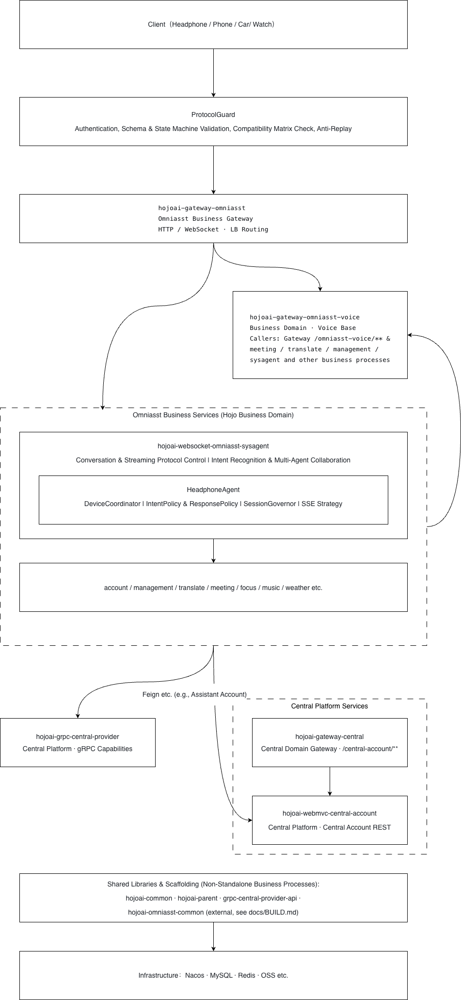

# 架构详解

名词定义、服务边界、路由要点与 **耳机智能体**（`headphoneMode` 编排及规划中的接入治理）。组件与端口说明见 [README](../README_zh.md#组件与端口)。

---

## 名词与边界

| 术语 | 说明 |
|------|------|
| **中台** | `hojoai-gateway-central`、`hojoai-webmvc-central-account`、`hojoai-grpc-central-provider` |
| **Omniasst** | Hojo 业务域进程；客户端主要经 Omniasst 网关接入 |
| **语音** | 模块目录为 `hojoai-gateway-omniasst-voice`，Nacos 注册名常为 `hojoai-webmvc-omniasst-voice`（无同名 `webmvc` 目录）；详见下文 **语音** 条 |
| **客户端** | **不**经 `gateway-central`；对外主要经 **Omniasst 业务网关**（`hojoai-gateway-omniasst`）。中台账户由服务端经 **`central.account.base.url`**、Nacos + Feign 等访问 **`hojoai-webmvc-central-account`**。 |
| **到中台** | 业务侧多为注册发现上的 **Feign / gRPC / 配置 URL** |

---

## 实现与路由要点

- **接口定义与路由**：Nacos 注册名、完整路由与接口以 **dev** 配置、[hojoai-gateway-omniasst/API.md](../hojoai-gateway-omniasst/API.md) 及各模块文档为准。`hojoai-gateway-omniasst` 中的 rtc、news、knowledge、model 等下游可能仅有配置而**无**本仓源码。
- **语音**：本仓仅含 `hojoai-gateway-omniasst-voice`，在 Nacos 中注册为 `hojoai-webmvc-omniasst-voice`，供其它服务通过 Feign 调用；无单独的 `hojoai-webmvc-omniasst-voice` 目录模块。
- **会议**：本仓含 `hojoai-webmvc-omniasst-meeting`；经网关暴露的路径以上文 API 文档与 **dev** 配置为准。
- **天气**：`hojoai-webmvc-omniasst-weather` 在本仓，但 Omniasst 网关默认路由通常**不含** `/omniasst-weather/**`，多由直连或其它入口暴露。
- **日程服务（`hojoai-webmvc-omniasst-focus`）**：网关 `lb://` 目标与 Nacos 注册名均为 `hojoai-webmvc-omniasst-focus`。

---

## 耳机智能体

面向耳机、车机、手机等多端协同：**设备协同**（同会话多设备输入/输出/控制）与**协议可治理**（长期目标，接入侧以规划中的 **ProtocolGuard** 描述为准）。

### 实现状态（一览）

| 状态 | 位置 | 内容 |
|------|------|------|
| **规划中** | Client 外侧最外层 | **ProtocolGuard**：**Authentication**；**Schema & State Machine Validation**；**Compatibility Matrix Check**；**Anti-Replay**。**本仓库尚无独立实现**；与 [README 架构图](../README.md#架构) 最外圈对照即可，**现网仍直连两网关及既有鉴权**。 |
| **已体现** | `sysagent` | **`headphoneMode=true`** 下的 **HeadphoneAgent**（源码中或名 `HeadphoneAgentOrchestrator` 等）及 **DeviceCoordinator**、**IntentPolicy & ResponsePolicy**、**SessionGovernor**、**SSE Strategy**；与 ProtocolGuard **无运行时依赖**，日后可在产品上对齐策略/错误码。 |

**当前分层（与图对照）**：设备角色 **Earbud / Phone / Car / Watch**（耳机主走音频流，其它端走控制与展示）→ **接入**为 `hojoai-gateway-omniasst-voice` 与 `hojoai-gateway-omniasst` → **编排**为上述 HeadphoneAgent 体系，其中**意图路由引擎（`IntentionServiceImpl`）为闭源代码**，通过 `AgentRegistry` SPI 与各 Agent 解耦 → **能力**为 `management`、**Redis**、music/weather/focus/meeting 等垂直服务。

### 当前数据路径（无 ProtocolGuard）

1. **Earbud** → `hojoai-gateway-omniasst-voice`（ASR/TTS）；**Phone / Car / Watch** → `hojoai-gateway-omniasst`（HTTP/WebSocket）。  
2. **ASR 文本** → 经 Omniasst 路由进入 **`sysagent` `/conversation/chat`（`headphoneMode=true`）** 做意图编排（见 [sysagent API](../hojoai-websocket-omniasst-sysagent/API.md)）。  
3. **HeadphoneAgent** → **意图路由引擎**（闭源，`ROUTED_NON_CHAT_AGENTS` / `HEADPHONE_BUBBLE_TO_SPEECH_AGENTS` 分发）→ **Redis**（如 `userId-sessionId-deviceId-role`）、**`management`**、各 **垂直 Agent**；**SSE Strategy** 控制流式输出与端侧分流。

### 主从与接力

- **主设备**（多为手机）：身份、主会话上下文与网络通道。  
- **从设备**（耳机/手表/车机）：采音、播报、按键与设备事件。  
- **策略**：同 `sessionId` 多 `deviceId`，`role`（input/output/control）决定发声、展示与接管。  
- **接力示例**：耳机发起语音 → 手机出卡片 → 车机播报/控制。

### 规划：ProtocolGuard、协议目标与第三方准入

**说明**：以下均为**产品与协议目标**，非本仓已交付的自动化流水线。

- **与 HeadphoneAgent 的分工**：将来由 ProtocolGuard 收口接入侧强约束；编排侧已由 `headphoneMode`、`inputs.user_now_date`、SSE、`/stop` 等落实会话与交互策略（见 [sysagent API](../hojoai-websocket-omniasst-sysagent/API.md)）。  
- **协议目标（摘要）**：Core 字段语义固定；Extension 仅允许 `extensions.vendorNamespace.*`；规划中的签名/防重放、版本与能力集协商、状态机非法序列拦截。  
- **第三方准入（叙事对齐）**：注册 → 官方 SDK/协议画像 → 沙箱 → **SchemaGate**（Schema/状态机）→ **SecurityGate**（鉴权、防重放）→ **CompatGate**（兼容矩阵）→ 准产审批；上线后若落地 ProtocolGuard 再做运行时收口。**当前无独立 ProtocolGuard 进程。**

### `sysagent` 子模块

| 模块 | 职责 | 连线 |
|------|------|------|
| **HeadphoneAgent** | `headphoneMode` 编排脑核 | `/chat`、`/rechat`、`/stop` |
| **DeviceCoordinator** | 主从、绑定、接力 | Redis、设备事件 |
| **SessionGovernor** | 按业务日会话、锁、跨日 | management、Redis |
| **IntentPolicy & ResponsePolicy** | 意图与回复形态 | 各垂直 Agent |
| **SSE Strategy** | 语音优先、端侧分流、与重聊/停止配合 | management、SSE |
| **意图路由引擎**（`hojoai-routing-engine` JAR，**闭源**） | `ROUTED_NON_CHAT_AGENTS` / `HEADPHONE_BUBBLE_TO_SPEECH_AGENTS` 集合定义、switch 分发逻辑、`agentType` SSE 事件发送 | 由 `SysagentAgentRegistry`（在 `sysagent` 中）通过 `AgentRegistry` SPI 注入各 Agent；通过 `StopSignalProvider`（`SseEmitterManager` 实现）检查停止信号；接口定义在 `hojoai-routing-engine-contract`（**开源**，在本仓库） |
| **Agent 注册中心**（`SysagentAgentRegistry`） | 在 `@PostConstruct` 中向路由引擎注册全部 9 个 Agent 实例（chat / doc / translator / meeting / focus / music / weather / podcast / websearch） | 注入各 `AgentService` 实现并以字符串类型注册 |

### API 索引

字段、事件与接入细节：**[hojoai-gateway-omniasst-voice/API.md](../hojoai-gateway-omniasst-voice/API.md)**（耳机 ASR 等）· **[hojoai-websocket-omniasst-sysagent/API.md](../hojoai-websocket-omniasst-sysagent/API.md)**（`headphoneMode`、`inputs.user_now_date`、SSE）。