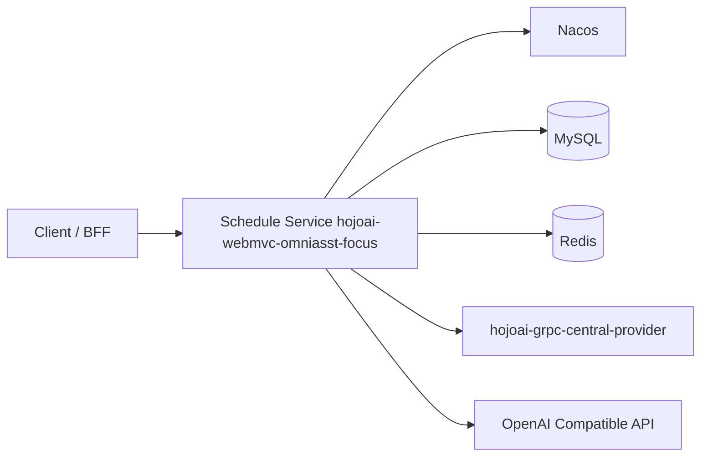

# hojoai-webmvc-omniasst-focus

**Omniasst Schedule Service**: Provides schedule creation and queries, rule engine, AI-assisted summarization, external itinerary aggregation (flights/trains/movies, etc.), exposed via HTTP.

## Capabilities

- Schedule Management: Create, query, update, delete schedules (v1/v2 API)
- AI-assisted Creation: Natural language schedule creation, conflict detection, AI summarization
- External Itinerary Aggregation: Flight, train, movie itinerary sync
- Focus Mode: Focus mode scheduling and agenda management
- Daily Brief: Daily schedule briefing generation
- External Data Integration: Map search, third-party itinerary APIs

## System Location



| Dependency | Description |
|------|------|
| JDK | 21 |
| MySQL / Redis | Business and cache; table schema see [document/schema.md](./document/schema.md) |
| Nacos | Registration and optional remote configuration |
| gRPC Central Service | Enums, constants, etc. ([hojoai-grpc-central-provider](../hojoai-grpc-central-provider)) |
| Spring AI | `spring.ai.openai.*` etc. |

## Module Description

| Module | Description |
|------|------|
| `hojoai-webmvc-omniasst-focus-server` | Spring Boot executable service |

## Runtime Conventions

| Item | Description |
|------|------|
| Default HTTP Port | `12008` |
| context-path | `/omniasst-focus` |
| Configuration | `.../config/application-dev.properties` (do not commit real secrets) |

## Build and Run

```bash
cd hojoai-webmvc-omniasst-focus
mvn clean install
cd hojoai-webmvc-omniasst-focus-server && mvn spring-boot:run
```

For build, Docker, and Kubernetes details, see [deploy.md](./deploy.md) (default **dev**).

## Documentation Index

| Document | Content |
|------|------|
| [deploy.md](./deploy.md) | Build and deployment |
| [API.md](./API.md) | External HTTP paths (can cross-reference with `document/API.md`) |
| [document/API.md](./document/API.md) | API path reference |
| [document/schema.md](./document/schema.md) | Database table documentation |
| [FAQ.md](./FAQ.md) | FAQ |

Brand-related response headers are generally injected by the **gateway**, not implemented within this service.