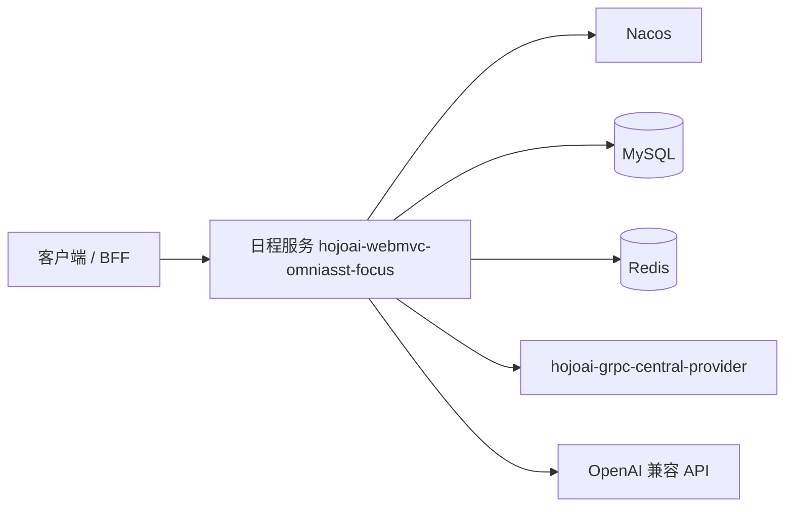

# hojoai-webmvc-omniasst-focus

**Omniasst 日程服务**：提供日程创建与查询、规则引擎、AI 辅助摘要、外部行程（航班/火车/电影等）聚合等能力，通过 HTTP 对外暴露。

## 能力列表

- 日程管理：创建、查询、更新、删除日程（v1/v2 API）
- AI 辅助创建：自然语言创建日程、冲突检测、AI 摘要生成
- 外部行程聚合：航班、火车、电影等行程同步
- Focus 模式：专注模式调度与日程安排
- 日常简报：每日日程简报生成
- 外部数据集成：地图搜索、第三方行程 API

## 系统位置



| 依赖 | 说明 |
|------|------|
| JDK | 21 |
| MySQL / Redis | 业务与缓存；表结构见 [document/schema.md](./document/schema.md) |
| Nacos | 注册与可选远程配置 |
| gRPC 中央服务 | 枚举、常量等（[hojoai-grpc-central-provider](../hojoai-grpc-central-provider)） |
| Spring AI | `spring.ai.openai.*` 等 |

## 模块说明

| 模块 | 说明 |
|------|------|
| `hojoai-webmvc-omniasst-focus-server` | Spring Boot 可执行服务 |

## 运行约定

| 项目 | 说明 |
|------|------|
| 默认 HTTP 端口 | `12008` |
| context-path | `/omniasst-focus` |
| 配置 | `.../config/application-dev.properties`（勿提交真实密钥） |

## 构建与运行

```bash
cd hojoai-webmvc-omniasst-focus
mvn clean install
cd hojoai-webmvc-omniasst-focus-server && mvn spring-boot:run
```

构建、Docker 与 Kubernetes 详见 [deploy.md](./deploy.md)（默认 **dev**）。

## 文档索引

| 文档 | 内容 |
|------|------|
| [deploy.md](./deploy.md) | 构建与部署 |
| [API.md](./API.md) | 对外 HTTP 路径（与 `document/API.md` 可对照维护） |
| [document/API.md](./document/API.md) | API 路径一览 |
| [document/schema.md](./document/schema.md) | 数据表说明 |
| [FAQ.md](./FAQ.md) | 常见问题 |

品牌类响应头一般由 **网关** 注入，本服务内不实现。
