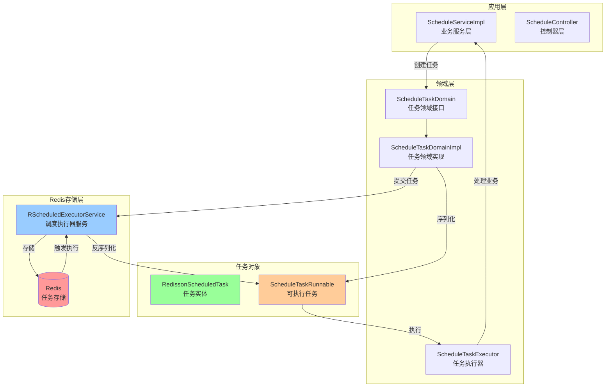
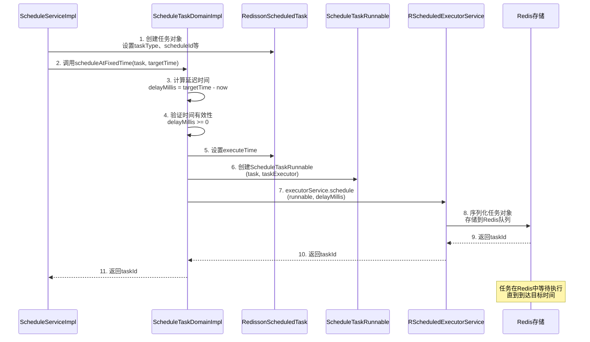
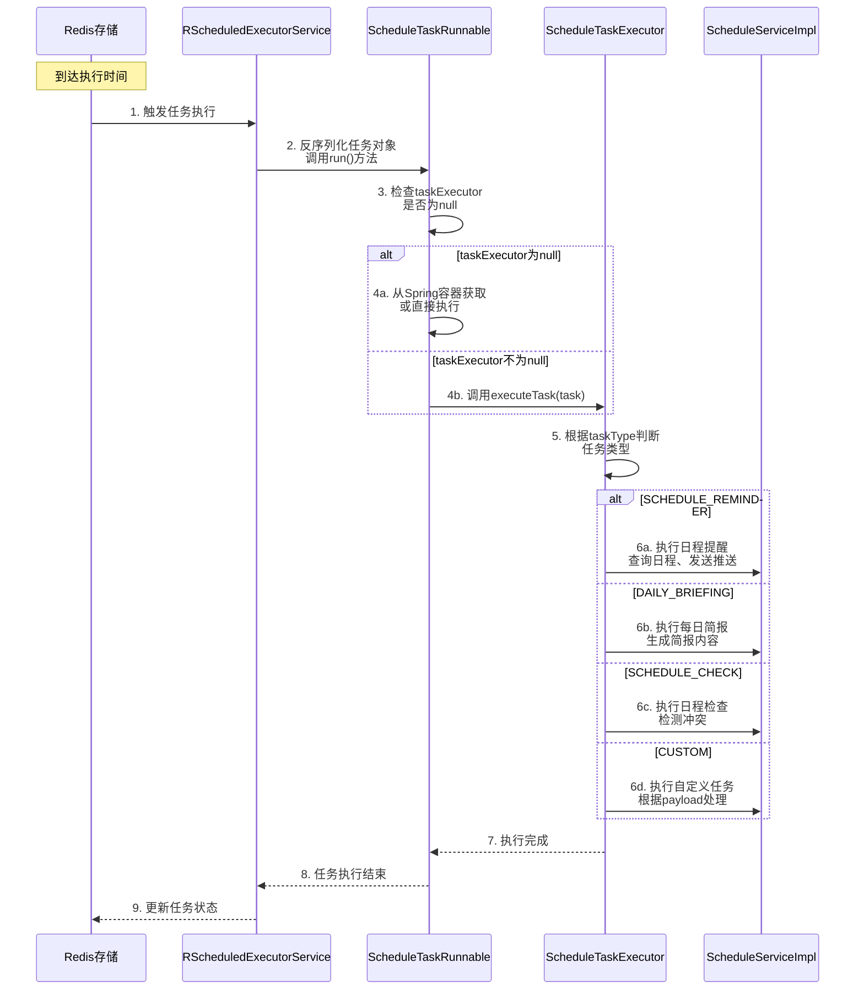
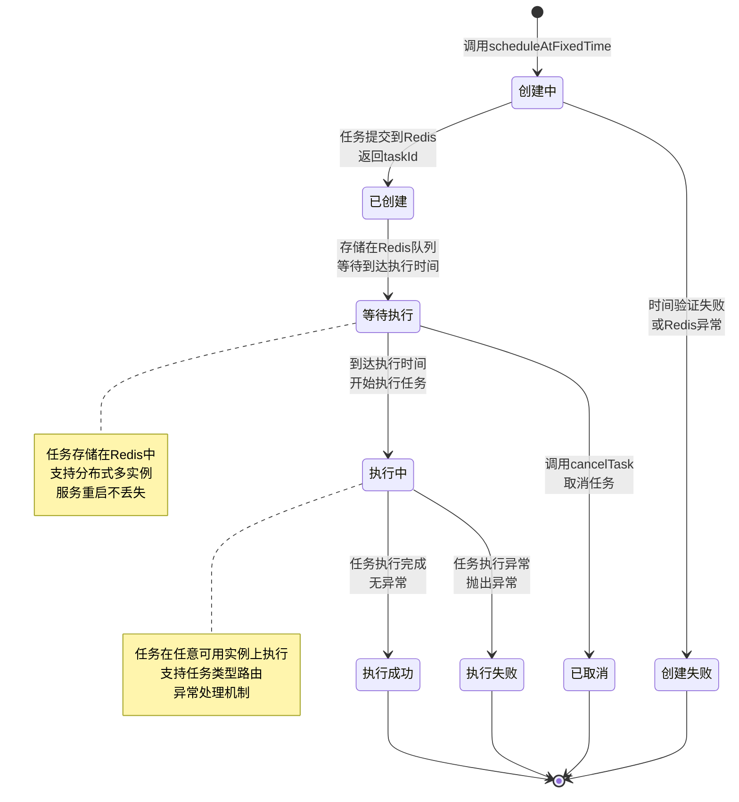
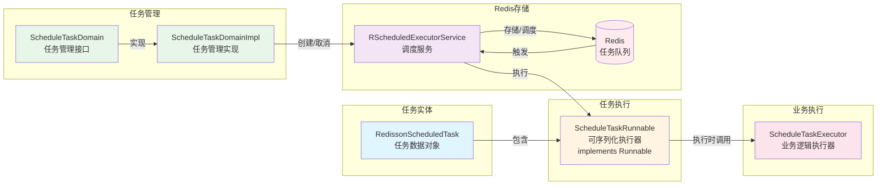
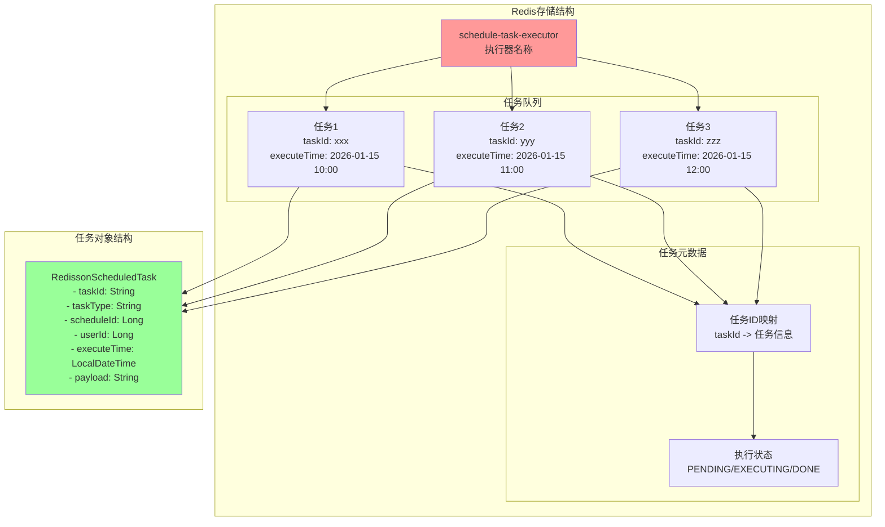
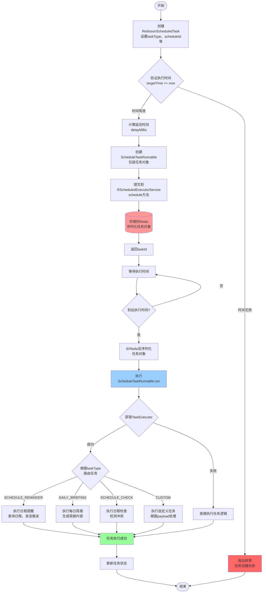

# 定时任务管理流程图

## 1. 整体架构图

## 2. 任务创建流程

## 3. 任务执行流程

## 4. 任务生命周期状态图

## 5. 任务管理组件关系图

## 6. 任务存储结构图

## 7. 完整任务管理流程图

## 关键要点总结

### 1. 存储位置
- **Redis**: 所有任务存储在Redis中，通过Redisson的`RScheduledExecutorService`管理
- **执行器名称**: `"schedule-task-executor"`
- **持久化**: 任务序列化后存储在Redis队列中，服务重启不丢失

### 2. 任务创建
- 创建`RedissonScheduledTask`对象，设置任务属性
- 计算延迟时间（目标时间 - 当前时间）
- 创建`ScheduleTaskRunnable`包装任务
- 提交到`RScheduledExecutorService`，返回`taskId`

### 3. 任务执行
- Redis在到达执行时间时触发任务
- 反序列化`ScheduleTaskRunnable`对象
- 调用`run()`方法执行任务
- 根据`taskType`路由到不同的业务处理逻辑

### 4. 任务取消
- 通过`taskId`调用`cancelTask()`方法
- 从Redis队列中移除任务
- 已执行的任务无法取消

### 5. 分布式特性
- 多实例共享Redis中的任务队列
- 任务在任意可用实例上执行
- 支持高可用和负载均衡
