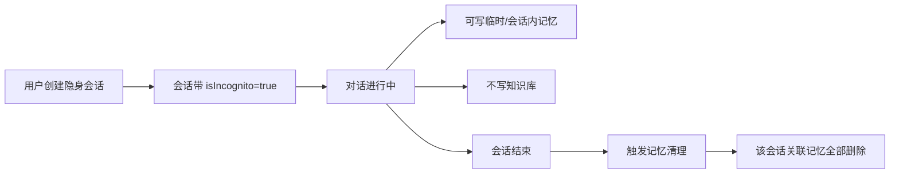
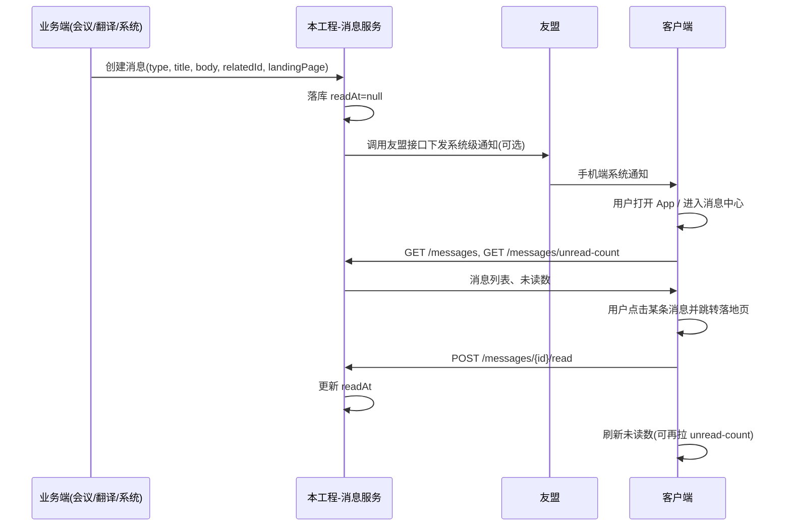
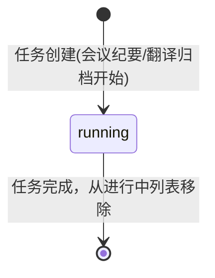
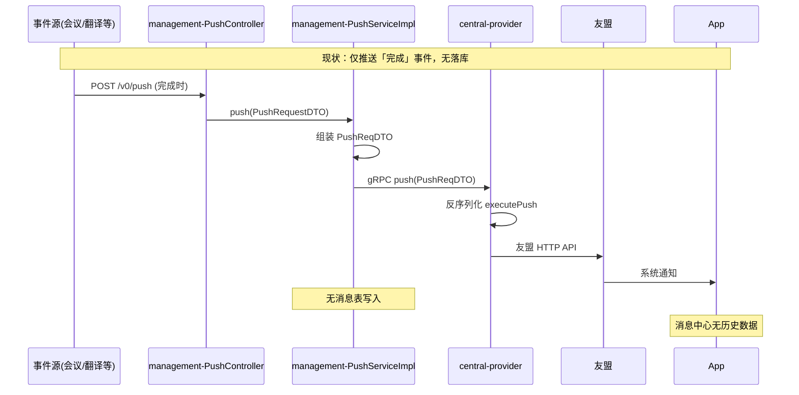
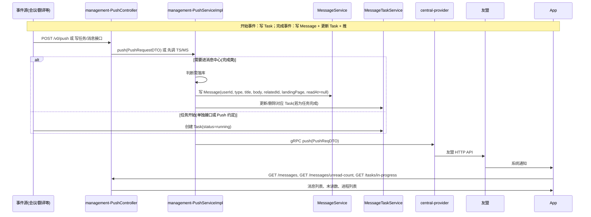

# PA 首页相关后端设计文档（初版）

本文档面向 PA 海外版首页相关后端能力，按功能点分为：隐身会话、对话历史时间戳、消息中心、为你推荐、分享到 PA。

**落地工程**：
- **消息中心**不采用独立服务与长连接。消息与进程任务在**本工程 `hojoai-webmvc-omniasst-management`** 内落库并提供 REST 接口；**系统级通知**直接通过**友盟**接口下发到手机端。App 内消息中心作为「用户与系统的聊天框」，持久化系统发给用户的提醒，支持已读/未读，用户可在消息中心查看历史与未读。详见第三节 3.12、3.13。
- **隐身会话**、**对话历史时间戳**若由本工程提供接口则在本工程内实现，否则与对应服务（如对话/会话服务）协作；接口与数据模型约定以本文档为准。

---

## 一、隐身会话（无痕模式）

### 1.1 需求摘要

- 用户可创建「隐身对话」，体验类似浏览器无痕模式。
- **知识**：不写入知识库，不产生持久化知识沉淀。
- **记忆**：对话过程中可正常使用记忆（保证上下文连贯），但会话结束后**全部删除**，不保留。
- 隐身会话**不计入对话历史列表**（侧边栏不展示）。

### 1.2 设计结论

| 维度 | 结论 |
|------|------|
| 会话标识 | 会话带 `isIncognito` 标记，创建时由客户端传入。 |
| 对话历史列表 | 列表接口默认只返回非隐身会话；隐身会话不展示、不参与排序。 |
| 知识库 | 隐身会话上下文不触发知识写入；若由统一入口写入，需根据 `isIncognito` 过滤。 |
| 记忆 | 对话进行中可写临时记忆/会话内记忆；会话结束（关闭/超时）后，由后端**统一清理**该会话关联的全部记忆，不保留。 |
| 持久化 | 会话元数据（如 sessionId、isIncognito、createdAt）是否落库由业务决定；若落库，仅用于「排除在历史列表外」及「触发记忆清理」，不用于知识沉淀。 |

### 1.3 数据与接口约定

**会话模型（建议字段）**

- `sessionId`：会话唯一标识（与主对话接口中的 **conversationId** 同义，列表与清理接口可统一使用该标识）  
- `userId`：用户  
- `isIncognito`：是否隐身  
- `createdAt` / `updatedAt`：用于列表排序与生命周期  

**对话历史列表接口**

- 请求：`userId`、分页参数；可选 `excludeIncognito`，默认 `true`。  
- 响应：会话列表，**仅包含非隐身会话**，并按「对话历史时间戳」规则带 `dateLabel` 等。  

**记忆清理触发**

- 在「会话结束」时（由客户端上报会话关闭，或服务端根据最后活动时间超时判断），对 `sessionId` 关联的记忆执行**全部删除**。  
- 需记忆服务提供「按 sessionId 删除」或「按 sessionId 标记为隐身并批量清理」能力。  

### 1.4 流程说明



### 1.5 与主对话接口的对接设计（/chat）

主对话能力由 **hojoai-websocket-omniasst-sysagent** 工程提供，入口为 `ConversationController` 的 **POST `/omniasst-sysagent/v0/conversation/chat`**，请求体为 `ConversationRequest`，用户身份从请求头 `X-User-Id` 获取。以下基于该接口的现有实现，说明隐身对话的改造要点与分工（**仅设计约定，不涉及具体代码改动**）。

#### 1.5.1 现有 /chat 流程概览

| 环节 | 说明 | 涉及组件 |
|------|------|----------|
| 请求入参 | `ConversationRequest`：含 `conversationId`、`avatarId`、`contents`、`inputs`、`responseMode`，**当前无 `isIncognito`** | sysagent |
| 会话与消息 ID | `ConversationManagement.createConversationAndMessageId(conversationId, userId)`，通过 Feign 调用 **hojoai-webmvc-omniasst-management** 的「创建会话并返回 messageId」 | management |
| 对话处理 | `ConversationService.processChat` → `callChatRequest`：意图识别、Agent 调度、流式输出，过程中将待存消息放入内存队列 | sysagent |
| 消息落库 | 单轮结束后 `saveChatMessage`：组装用户+助手消息，调用 **management** 的 `saveConversationMessages` 持久化 | sysagent → management |
| 上下文 | `saveContextToRedis(conversationId, messages)`：按会话维度写入 Redis，用于后续轮次上下文（条数上限、TTL） | sysagent |
| 标题 | `saveConversationTitle`：调用 management 的 `updateConversationTitle` | sysagent → management |
| 记忆 | `saveMessagesToMemory(userId, messages, ...)`：通过 `MemoryUtils.storeMessageList(PA_MEMORY_GROUP_ID, userId, ...)` 写入，**当前仅按 userId（及 groupId）维度，未带 conversationId** | sysagent → 记忆服务 |
| 知识 | 当前在 sysagent 工程内**未发现**直接的知识写入逻辑；若知识由 Agent 或下游服务在对话中触发写入，需在**统一写入入口**根据会话是否隐身做过滤 | 待对接 |

#### 1.5.2 隐身对话的改造要点

**（1）请求与会话标识**

- 在 **ConversationRequest** 中增加 **`isIncognito`**（Boolean，可选，默认 false）。
- 客户端创建「隐身对话」时：可生成新的 `conversationId`（如 UUID）并在请求中携带 **`isIncognito=true`**；后续该会话内每条 /chat 请求均带同一 `conversationId` 与 `isIncognito=true`。

**（2）会话与 messageId 的创建策略（两种方式均保留，评审时选定）**

| 方案 | 行为 | 优点 | 注意 |
|------|------|------|------|
| **A：management 支持隐身创建** | 仍调用 management 的「创建会话」接口，请求体增加 `isIncognito`；management 落库会话元数据并标记 `isIncognito`，返回 `conversationId`、`messageId`。 | 多端、超时、列表过滤等逻辑统一在 management；会话结束时可复用「删除会话」做一次性清理。 | management 需新增/扩展创建接口入参及列表过滤。 |
| **B：隐身不落库会话** | `isIncognito=true` 时不调 management 创建会话，sysagent 本地生成 `conversationId` 与 `messageId`，仅用于当次会话与 Redis。 | management 无需改创建逻辑。 | 需保证所有依赖「从 management 取会话/消息」的路径对隐身会话有分支或兼容；会话结束仅清理 Redis 与记忆。 |

评审时可从「改动范围、运维一致性、多端与超时能力」等维度在 A、B 中选定一种落地。

**（3）对话过程中的行为（isIncognito=true 时）**

| 行为 | 当前实现 | 隐身约定 |
|------|----------|----------|
| **消息持久化** | `conversationAPI.saveConversationMessages(messages)` 写入 management | **不调用**：隐身会话的聊天记录不落库；上下文仅依赖 Redis。 |
| **上下文** | `saveContextToRedis(conversationId, messages)` | **保持**：继续写入 Redis，保证当轮及同会话内多轮上下文连贯；会话结束时删除该 conversationId 的 Redis 键。 |
| **标题** | `saveConversationTitle` → management `updateConversationTitle` | **不调用**：隐身会话不展示在历史列表，无需标题。 |
| **记忆写入** | `saveMessagesToMemory(userId, messages, ...)`，按 userId 写入 | **二选一**：① **不调用**（仅用 Redis 上下文保证连贯，会话结束只清 Redis）；② 若记忆服务支持「按 conversationId 维度的会话内记忆」且支持「按 conversationId 清理」，则可写入并在会话结束时调用清理。 推荐先采用①，实现简单。 |
| **知识写入** | 未在 sysagent 内发现；若在 Agent 或其它服务中触发 | **统一约定**：任何「对话过程中生成知识并落库」的入口，需能获知当前会话是否隐身（如从请求/上下文带出 `isIncognito`），若为隐身则**不落库**。 |

**（4）会话结束时的清理**

- **触发方式**：客户端主动关闭隐身会话时上报「会话结束」（如调用 management 或 sysagent 提供的「结束会话」接口，携带 `conversationId` + `isIncognito=true`）；或服务端根据该会话最后活动时间超时判定结束。
- **清理动作**：  
  - **Redis**：删除该 `conversationId` 对应的上下文键（与现有 `CONVERSATION_CONTEXT_PRE + conversationId` 约定一致）。  
  - **记忆**：若采用「按 conversationId 写入」则调用记忆服务「按 conversationId/sessionId 删除」该会话关联记忆；若采用「隐身不写记忆」则无需删记忆。  
  - **会话与消息**：若采用方案 A（隐身也会话落库），则调用 management 的「删除会话」接口，一次性删除该会话及其消息；若采用方案 B，则无需删库（未写入）。

**（5）对话历史列表**

- 对话历史列表由 **hojoai-webmvc-omniasst-management** 提供（或由聚合本工程与其它数据源的网关提供）。
- 列表接口需**默认排除** `isIncognito=true` 的会话（或请求参数 `excludeIncognito` 默认为 true），侧边栏仅展示非隐身会话。

#### 1.5.3 工程分工小结

| 工程/能力 | 职责 |
|-----------|------|
| **hojoai-websocket-omniasst-sysagent** | 在 `ConversationRequest` 中接收 `isIncognito`；在 `processChat`/`saveChatMessage` 等流程中按 `isIncognito` 分支：不落库消息、不更新标题、可选不写记忆；会话结束时触发 Redis 清理及（若需要）记忆清理、会话删除。 |
| **hojoai-webmvc-omniasst-management** | 若采用方案 A：创建会话接口支持 `isIncognito` 并落库；对话历史列表接口过滤掉隐身会话；提供「结束/删除会话」供隐身会话结束时清理。 |
| **记忆服务** | 若采用「按 conversationId 写入+清理」：提供按 conversationId/sessionId 的写入与删除能力；否则仅需保证隐身会话不写入持久化记忆即可。 |
| **知识写入方** | 任何在对话中触发知识落库的模块，需根据会话的 `isIncognito` 标记跳过写入。 |

#### 1.5.4 与 1.1～1.4 的对应关系

- **1.1 需求摘要**：对话中正常保存上下文（Redis + 可选会话内记忆）、退出后删除聊天记录与上下文，由 1.5.2（3）（4）落实；知识不落库由 1.5.2（3）知识行及 1.5.3 知识写入方落实。
- **1.2 设计结论**：`isIncognito` 由客户端在请求中传入；历史列表不展示隐身由 1.5.2（5）与 management 列表过滤落实；记忆「会后删」由 1.5.2（4）清理动作落实。
- **1.3 数据与接口约定**：会话模型中的 `sessionId` 与当前实现的 `conversationId` 对应；记忆清理触发在 1.5.2（4）中具体化为 Redis + 可选记忆删除 + 可选会话删除。

---

## 二、对话历史时间戳

### 2.1 需求摘要

- 对话历史按**自然日**分组展示：今天（不标「今天」）、昨天、更早日期（如 2026-02-04）。  
- 某条历史有新消息时，归入「今天」并刷新排序。  
- 时区以用户**当前所在时区**为准（Oversea 场景）。

### 2.2 设计结论

- **由后端根据 `updatedAt` + 用户时区计算自然日，并直接返回分组标签 `dateLabel` 给前端**，前端按标签分组展示即可，无需再算日期。  

### 2.3 时间与分组规则

| 条件 | dateLabel | 说明 |
|------|-----------|------|
| 会话最后活动日在「今天」 | `today` | 当日不展示「今天」文案时由前端决定，后端只给标签 |
| 会话最后活动日在「昨天」 | `yesterday` | 昨日 |
| 更早 | `YYYY-MM-DD` | 如 `2026-02-04` |

- **排序**：先按 `dateLabel` 的日期顺序（今天 > 昨天 > 更早），同组内按 `updatedAt` 倒序。  
- **用于分组的时间**：以会话的 `updatedAt` 为准（最后活动时间），有新消息即更新，便于「归到今天」。  

### 2.4 接口约定

所有接口返回值统一使用 `com.hojoai.common.response.Response<T>` 包装（`resCode` + `resMessage` + `data`），与其他项目保持一致。

**会话列表（供侧边栏对话历史）**

- 请求  
  - `userId`：用户  
  - `timezone`：IANA 时区，如 `America/New_York`、`Asia/Shanghai`（必填或带默认）  
  - 分页：如 `page`、`pageSize` 或 cursor  

- 响应  

```json
{
    "resCode": "OK",
    "resMessage": "成功",
    "data": {
        "list": [
            {
                "sessionId": "xxx",
                "title": "会话标题",
                "updatedAt": "2026-03-11T10:30:00Z",
                "dateLabel": "today"
            }
        ],
        "page": 1,
        "pageSize": 20,
        "total": 56
    }
}
```

  - `dateLabel` 取值：`"today"` / `"yesterday"` / `"YYYY-MM-DD"`  
  - 列表已按「日期组 + updatedAt 倒序」排好，前端按 `dateLabel` 分组展示即可。  

**时区未传时**：可采用账号默认时区或请求头约定，在接口文档中说明。  

### 2.5 历史消息查询与分级（小结）

历史消息查询即**侧边栏对话历史列表**：按用户维度拉取会话列表，并按**自然日**分级展示，逻辑单一，由后端一次返回带 `dateLabel` 的列表，前端按标签分组渲染即可。

**接口职责**

- **提供方**：对话历史列表由 **hojoai-webmvc-omniasst-management** 提供（与隐身会话列表过滤、会话元数据同源）。
- **能力**：一条「会话列表」查询接口，入参含 `userId`、`timezone`、分页；出参为会话列表，**每条会话带分级标签 `dateLabel`**，且列表已按分级与时间排好序。

**分级规则（与 2.3 一致）**

| 会话最后活动日（按用户时区） | dateLabel     | 前端展示说明     |
|-----------------------------|---------------|------------------|
| 今天                        | `today`       | 当日可不展示「今天」文案 |
| 昨天                        | `yesterday`  | 昨日             |
| 更早                        | `YYYY-MM-DD`  | 如 2026-02-04    |

- **用于分级与排序的时间**：会话的 `updatedAt`（最后活动时间）；有新消息即更新，该会话归入「今天」并刷新排序。
- **排序**：先按日期组（今天 > 昨天 > 更早），同组内按 `updatedAt` 倒序。

**与需求文档的对应**

- 需求：「以自然日为分割依据」「今天不标今天、昨天、更早标日期」「新内容归入今天」「按用户所在时区判定」——均由后端根据 `updatedAt` + 请求中的 `timezone` 计算自然日并返回 `dateLabel`，前端无需再算日期，仅按 `dateLabel` 分组展示即可。

---

## 三、消息中心

**落地说明**：本节约定消息中心的能力、数据模型与接口。消息中心**不采用独立服务与 WebSocket 长连接**；通知通过**友盟**直接下发到手机端，消息同步落库；App 内消息中心作为「用户与系统的聊天框」，展示系统发给用户的提醒并支持已读/未读。详见 3.12、3.13。

### 3.1 功能概述

消息中心为 PA 内**长耗时任务进度**与**各类通知**的统一入口，产品上类似「用户与系统的聊天框」：系统将提醒写入消息表并可通过友盟触达手机端，用户在 App 内打开消息中心查看历史、未读与进程任务。

1. **消息列表**：会议/翻译/系统等通知持久化在消息表中，**支持未读/已读**；未读提醒（如「·」）由前端根据未读数量展示；用户点击某条并跳转落地页后记为已读。新消息产生时**同步落库**，并可通过**友盟**下发系统级通知到手机端，用户点击通知进入 App 后可在消息中心看到列表。  
2. **进程任务列表**：进行中的任务（如会议纪要生成、翻译总结归档）持久化在任务表中，仅展示进度，**不参与未读统计**；用户打开消息中心时通过 REST 接口拉取进程列表与数量角标（1～99+）。  
3. **通知方式**：不建自有长连接；**友盟**负责系统级通知到设备，用户打开 App 或进入消息中心时通过 **REST 接口**拉取消息列表、进程列表与未读数即可。  
4. **系统 Push**：仅「系统消息」可触发系统级 Push（具体策略见后台需求）；会议/翻译等通知亦可按产品需要走友盟下发，本方案约定消息体与已读/未读规则，推送对接见 3.15。  

### 3.2 概念区分

| 概念 | 说明 | 是否参与未读 |
|------|------|----------------|
| **消息（Message）** | 任务完成或系统触发的通知，可点击跳转 | 是 |
| **进程任务（Task）** | 进行中的长耗时任务，仅展示状态 | 否 |

- **未读数**只统计「消息」表，不统计进程任务表。  
- **任务开始**：仅新增一条进程任务条目，不产生消息 → 未读数不变；仅影响「进程任务列表」与角标（1～99+）。  
- **任务完成**：会**同时产生一条消息**（如「会议纪要已生成」），该消息未读，故未读数 +1；进程任务从进行中列表移除，角标减 1。即「完成」带来的未读 +1 来自这条新消息，而不是进程任务本身参与未读统计。

#### 3.2.1 为何区分消息与进程？能否统一成「仅消息」？

**当前区分的逻辑**

- 文档把「消息」和「进程任务」拆成两个概念，主要出于两点：  
  1. **未读语义**：未读只计「有结果、可点击」的完成类通知；「进行中」还没有结果，不点进去看也没关系，所以不计未读，只做角标。  
  2. **数据形态**：完成类 = 一条通知（标题、正文、落地页、已读）；进行中 = 一条任务（标题、进度/预估时间、无已读）。  

**若本版不做进度条、只做预估时间**

- 进行中的展示就变成：一条卡片，例如「会议纪要生成中」，副文案「预计还需约 2 分钟」，没有进度条。  
- 从数据形态看，**进程完全可以视为「消息的一种」**：同一张表里用 **status**（如 `running` / `completed`）或 **kind**（如 `in_progress` / `notification`）区分即可。  
  - **进行中**：status=running，有 `estimatedSeconds`（或 `estimatedRemainingSeconds`），不参与未读（或约定 readAt 对 running 不参与未读统计）。  
  - **已完成**：status=completed（或仅「完成类」消息无 status，默认即完成），参与未读/已读。  
- 这样**只保留一张「消息」表**即可：  
  - 未读数 = 该用户下 status 为完成且 `readAt == null` 的条数。  
  - 进行中角标 = 该用户下 status=running 的条数。  
  - 列表可一次拉取，前端按「进行中」和「已完成」分区展示，或按时间线混排。  

**结论**：本方案**采用「消息表 + 进程任务表」双表**。进程任务表专门持久化进行中的任务，这样用户在一次会话中开始任务后若退出 App 再进入，仍可通过接口拉取到未完成任务并展示（如「会议纪要生成中，预计还需 2 分钟」），体验一致。若采用单表（进程也算消息的一种），虽也可落库实现同样效果，但双表在语义与查询上更清晰（未读只查消息表、进行中只查任务表）。下文 3.4、3.6、3.16 均按双表设计。  

### 3.3 消息类型与来源

| 类型 type | 产生来源 | 展示要点 | 落地页/跳转 |
|-----------|----------|----------|-------------|
| `meeting` | 会议纪要转写完成 | 标题、纪要标题、图标 | 纪要详情页 |
| `translation` | 翻译总结完成 | 标题、总结标题、图标 | 翻译总结浮层（不跳转翻译模块） |
| `system` | 后台配置条件触发 | 标题、正文、图标 | 配置的落地页（如空间管理、订阅购买） |

- 系统消息的**触发条件、配置、与 Push 的联动**在后台需求中详述；本方案约定消息体结构与已读/未读规则。  

### 3.4 数据模型（建议）

**数据模型依据说明**

- 本节字段设计依据为：**(1) 本文档 3.1～3.3** 约定的能力（消息列表、类型 meeting/translation/system、未读/已读、关联业务与落地页）；**(2) 通用消息中心建模**：收件人、类型、标题与正文、关联业务 ID、跳转路径、创建时间、已读时间；**(3) 业务需求**：会议纪要/翻译总结需 relatedId、relatedTitle、landingPage，系统消息需配置化落地页等。未引用外部规范，为文档内需求推导与常见实践的结合。

**消息（Message）**

| 字段 | 类型 | 说明 |
|------|------|------|
| messageId | string | 主键 |
| userId | string | 用户 |
| type | enum | meeting / translation / system |
| title | string | 标题 |
| body | string | 正文/摘要 |
| relatedId | string | 关联业务 ID（纪要 ID、翻译 ID、系统配置 key 等） |
| relatedTitle | string? | 可选，关联业务标题（如该条会议纪要标题、翻译总结标题），供前端做双行展示 |
| landingPage | string | 可选，跳转路径或配置 key |
| createdAt | datetime | 创建时间 |
| readAt | datetime? | 已读时间，null 表示未读 |

**进程任务（Task）**

| 字段 | 类型 | 说明 |
|------|------|------|
| taskId | string | 主键 |
| userId | string | 用户 |
| type | enum | meeting / translation |
| title | string | 如会议纪要标题、翻译内容标题 |
| status | enum | running / completed |
| progressText | string | 进度文案 |
| estimatedSeconds | int? | 预计剩余秒数（可选） |
| createdAt | datetime | 创建时间 |
| finishedAt | datetime? | 完成时间，完成后可从「进行中」列表移除或标记 completed |

- 进程任务**建议落库**，便于多端同步与刷新；任务完成后可保留短时间再物理删除或仅状态变更。  

（不采用「仅消息一张表」：为保障用户退出 App 再进入后仍能看到未完成任务，进行中状态需持久化；单独进程表语义清晰、查询简单，故采用消息表 + 进程任务表双表。）

### 3.5 未读与已读规则

**未读统计**

- 统计该用户下 `readAt == null` 的**消息**条数（不包含进程任务）。  
- 需求中的「自上一次打开消息中心之后新产生的未读」可理解为：  
  - 方案 A：仅统计「全部未读消息数」，前端在进入消息中心时可选调用「已读到某时刻」做一次快照。  
  - 方案 B：后端记录「用户上次打开消息中心的时间」，未读数 = 该时间点之后产生的消息中仍未读的数量。  
- **建议先采用方案 A**（简单可靠）：未读数 = 当前未读消息总数；进入消息中心后不自动全部标已读，仅用户点击某条并跳转成功后该条标已读。  

**已读判定**

- 用户**点击某条消息并跳转到落地页且页面成功展示**后，客户端上报该条 `messageId`，后端将 `readAt` 置为当前时间。  
- 接口：`POST /messages/{messageId}/read` 或批量 `POST /messages/read`（body: `messageIds[]`）。  

**未读红点**

- 当未读消息数 > 0 时，消息中心入口显示未读标识（如「·」）；数量可展示 1～99，超过显示 99+（若产品需要）。  

### 3.6 进程任务列表规则

- 仅展示 `status == running` 的任务；`completed` 或已结束的可从接口中过滤或移除。  
- 进程数量角标：进行中任务数，1～99，超过显示 99+；0 则不显示数字。  
- **进程列表区域**作为入口可点击，跳转目标由前端或路由配置决定（如统一进程列表页或按 type 进入各业务页）；**单条进程条目**不可点击，仅展示进度与时间预估。  
- 未读数只计消息表；进程条目的增删只刷新进程列表与角标。任务完成时因会新增一条消息，未读数会 +1（见 3.2）。  
- 消息列表为空时，GET /messages 返回空数组，前端展示空状态页。  

### 3.7 接口清单（本工程实现）

以下接口均在本工程内提供，路径可根据项目统一前缀（如 `/omniasst-management/api/v0`）调整。所有接口返回值统一使用 `Response<T>` 包装。

| 接口 | 方法 | 说明 |
|------|------|------|
| 消息列表 | GET /messages | 分页，按 createdAt 倒序 |
| 未读数量 | GET /messages/unread-count | 返回未读总数 |
| 单条已读 | POST /messages/{messageId}/read | 将 readAt 置为当前时间 |
| 批量已读 | POST /messages/read | body: `{ "messageIds": ["id1", "id2"] }` |
| 进程列表 | GET /tasks/in-progress | 仅返回 status=running，按 createdAt 倒序 |
| 进程数量 | GET /tasks/in-progress/count | 返回进行中任务数（用于角标） |

**各接口响应示例**

消息列表（GET /messages）：

```json
{
    "resCode": "OK",
    "resMessage": "成功",
    "data": {
        "list": [
            {
                "messageId": "msg_001",
                "type": "meeting",
                "title": "会议纪要已生成",
                "body": "项目周会纪要已完成",
                "relatedId": "minute_123",
                "relatedTitle": "项目周会 2026-03-11",
                "landingPage": "/meeting/minute/minute_123",
                "createdAt": "2026-03-11T10:30:00Z",
                "readAt": null
            }
        ],
        "page": 1,
        "pageSize": 20,
        "total": 5
    }
}
```

未读数量（GET /messages/unread-count）：

```json
{
    "resCode": "OK",
    "resMessage": "成功",
    "data": {
        "totalUnread": 3
    }
}
```

单条已读 / 批量已读（POST /messages/{messageId}/read、POST /messages/read）：

```json
{
    "resCode": "OK",
    "resMessage": "成功"
}
```

进程列表（GET /tasks/in-progress）：

```json
{
    "resCode": "OK",
    "resMessage": "成功",
    "data": {
        "list": [
            {
                "taskId": "task_001",
                "type": "meeting",
                "title": "项目周会纪要",
                "status": "running",
                "progressText": "正在生成会议纪要...",
                "estimatedSeconds": 120,
                "relatedId": "meeting_456",
                "createdAt": "2026-03-11T10:28:00Z"
            }
        ]
    }
}
```

进程数量（GET /tasks/in-progress/count）：

```json
{
    "resCode": "OK",
    "resMessage": "成功",
    "data": {
        "count": 2
    }
}
```

- **无长连接**：不维护 WebSocket；新消息与进程变更通过**友盟**下发系统级通知（可选），用户打开 App 或进入消息中心时通过上述 REST 接口拉取消息列表、进程列表与未读数。  
- **当前用户系统消息**：上述接口即用于 App 消息中心「查询当前用户的系统消息」；userId 从网关/登录上下文获取，详见 **3.16.6 App 查询当前用户系统消息的接口**。

### 3.8 通知与刷新策略

- **新消息**：消息落库后，若需触达用户则调用**友盟**接口下发系统级通知（标题、内容、跳转等）；用户点击通知进入 App 或主动打开消息中心时，通过 GET /messages、GET /messages/unread-count 拉取列表与未读数。  
- **进程任务**：任务开始/进度更新/完成时仅更新任务表；用户打开消息中心时通过 GET /tasks/in-progress 与 GET /tasks/in-progress/count 拉取进程列表与角标。  
- **未读标识**：进入首页或消息中心时调用 GET /messages/unread-count 更新入口红点；进入消息中心后按需拉取消息列表与进程列表。  
- **前端行为**：以后拉为主（打开消息中心、进入首页时拉取）；友盟通知仅负责「提醒用户有更新」，具体内容以 REST 接口为准。  

### 3.9 流程示意

**消息产生与已读**



**进程任务生命周期**



### 3.10 与后台需求的衔接

- **系统消息**：触发条件、模板、落地页配置在后台需求中详述；本工程内消息中心对系统消息的 `type=system`、`landingPage` 及已读/未读行为与上述规则一致。  
- **系统 Push**：仅对 `type=system` 的消息可触发系统级 Push；通过**友盟**下发，Payload 中可带 messageId、landingPage 等，便于点击跳转至 App 内对应页。友盟对接复用本工程现有 `PushController#push` 及 `PushService`（见 3.15）。

### 3.11 本工程内模块划分建议

在 `hojoai-webmvc-omniasst-management-server` 内可按现有分层风格扩展消息中心，并与既有 push 模块协作：

| 层次 | 建议 | 说明 |
|------|------|------|
| **Controller** | `controller.message.MessageController`、`controller.message.MessageTaskController`（或 `controller.task`） | 消息列表/未读/已读、进程列表/数量；需从上下文或网关获取 userId |
| **Service** | `service.message.MessageService`、`service.message.MessageTaskService` | 消息 CRUD、未读统计、已读更新；任务创建/完成、进行中列表；新消息落库后按需调用 PushService 经友盟下发 |
| **Mapper / 持久层** | `entity`、`mapper` 对应 Message、MessageTask 表 | 消息表、进程任务表；索引建议：userId + createdAt、userId + readAt |
| **推送** | 复用现有 `PushController`、`PushService`（友盟） | 仅系统消息或需触达用户的通知在写库后调用友盟接口（经 central provider gRPC）；无 WebSocket |
| **内部调用** | 会议/翻译等模块在「纪要完成」「总结完成」时调用本工程消息服务 | 通过 Feign 或本地 Service 创建消息、创建/结束进程任务 |

- 会议纪要完成、翻译总结完成等业务若已在本工程（如 `MeetingController`、`TranslationController`）内，可直接注入 MessageService/MessageTaskService 写入消息与任务；若在其他服务，可通过 HTTP/Feign 调用本工程提供的「创建消息」「创建/完成任务」接口（需在本工程内增加对内或对外的写接口并做鉴权）。消息落库后若需系统级通知，由本工程调用友盟（现有 push 能力）下发。  

### 3.12 消息中心架构：非独立服务，友盟推送（已确定）

消息中心**不采用独立服务与 WebSocket 长连接**，在本工程（`hojoai-webmvc-omniasst-management`）内实现。

| 维度 | 说明 |
|------|------|
| **部署** | 消息与进程任务在本工程内落库，REST 接口由本工程提供 |
| **通知方式** | **友盟**直接实现手机系统级通知；消息落库后若需触达用户则调用友盟接口（复用现有 `PushController#push`、`PushService`，经 central provider 调友盟） |
| **消息中心形态** | App 内消息中心为「用户与系统的聊天框」：持久化系统发给用户的提醒，支持已读/未读，用户打开消息中心时通过 REST 拉取消息列表、进程列表与未读数 |
| **业务接入** | 会议、翻译、系统等在本工程内可直接调用 MessageService/MessageTaskService；若在其他服务，可通过 HTTP/Feign 调用本工程「创建消息」「创建/完成任务」接口，本工程落库后按需调友盟下发 |

- **任务表**：保留，用于进行中任务的持久化与列表/角标；用户打开消息中心时拉取，无实时长连接。  
- **不使用 MQ**：业务方（会议、翻译、系统等）直接调本工程 Push 或消息/任务写接口，本工程内「推送 + 落库」统一在 Push 链路拦截完成。

### 3.13 与友盟的衔接

- 友盟可直接实现**手机系统级通知**，本工程无需自建长连接。  
- 本工程已具备 `PushController#push`（POST /v0/push）与 `PushService`，通过 **central provider 的 gRPC PushClient** 间接调用友盟；新消息落库后若需系统级触达（如系统消息或会议/翻译完成通知），在 MessageService 内调用 `PushService.push(PushRequestDTO)`，传入 userIdList、title、content、route 等即可。  
- 设备 token 由 App 上报至本工程 `POST /v0/device-token`，存 Redis（key：user_device_token:{userId}），供友盟下发时使用。  
- 系统消息的触发条件、模板、落地页与「是否走友盟」的规则在后台需求中详述；本方案仅约定：需系统级通知时统一经本工程现有 push 能力（友盟）下发。

### 3.14 与产品/设计确认清单

以下为**技术设计无法单独确定**、需与产品/设计对齐后再落实现状与接口的项，评审或与产品对需求时使用。

| 序号 | 事项 | 说明 |
|------|------|------|
| 1 | **未读统计口径** | 需求表述为「仅统计距离『上一次页面展示』后是否产生『未读消息』」。当前设计 3.5 给出方案 A（全部未读总数）与方案 B（仅统计「自上次打开消息中心之后」新产生且仍未读的消息）。需产品明确采用 A 或 B；若选 B，后端需记录用户「上次打开消息中心」时间并在接口中支持（如进入消息中心时上报或拉未读数时带 lastOpenAt）。 |
| 2 | **进程任务列表入口跳转目标** | 需求写「点击可跳转到其对应落地页」。若产品/交互对「对应落地页」有具体定义（如统一进程列表页 vs 按任务类型跳转至会议/翻译等业务页），需明确后前端或路由配置落地；技术侧已支持通过 type、relatedId 按类型跳转。 |

### 3.15 友盟推送与推送链路拦截落库

- 消息中心**不建长连接**，系统级通知统一通过**友盟**下发；本工程已具备 `PushController#push`、`PushService`，经 gRPC 调 central-provider 后由该服务调友盟。
- **推送并落库**：在 **management 的 `PushServiceImpl#push`** 中，在调用 `pushClient().push(...)` **之前**做一道拦截：若本条推送**需要进消息中心**（按 type / messageType 或约定标记判断），则先调用本工程 **MessageService** 将消息写入消息表（对 userIdList 逐条或按约定写），再执行原有 gRPC 推送。这样「推友盟」与「落消息库」在一条链路上完成，无需 MQ。
- **设备 token**：App 上报至 **POST /v0/device-token**，本工程存 Redis（key：`user_device_token:{userId}`），供 central-provider 调友盟时使用。
- **进程任务**：「开始」事件由事件源（会议、翻译等）调用本工程提供的**写任务接口**（或通过 Push 约定传「任务开始」参数由拦截层写 Task 表）；「完成」时事件源再调 Push，拦截层写 Message 并可选更新/删除 Task，再推友盟。详见 3.16。

### 3.16 推送与消息中心：现状、改动与实现要点

#### 3.16.1 现状

| 项目 | 说明 |
|------|------|
| **推送入口** | 本工程 `PushController#push`（POST /v0/push），入参 `PAPushRequestDTO`，转成 central-provider 的 `PushRequestDTO` 后调 `PushService.push()`。 |
| **推送实现** | `PushServiceImpl#push` 仅将 `PushRequestDTO` 序列化进 `PushReqDTO.pushReqStr`，通过 gRPC 调用 **hojoai-grpc-central-provider** 的 Push 服务；**无写库、无与消息表交互**。 |
| **central-provider** | 收到 gRPC 后反序列化 `PushRequestDTO`，按 broadcast / 单用户 / 多用户调用 `UMengDomainService`（broadcastNotification、unicastMessage、sendNotificationToUsers），最终请求友盟 HTTP API 下发。 |
| **事件源** | 会议、翻译等场景**目前仅推送「完成」类事件**（如纪要生成完成、翻译总结完成），**没有推送「开始」事件**；进程任务列表若需展示「进行中」，需事件源增加「开始」推送或调用写任务接口。 |
| **消息持久化** | 当前推送链路**不落消息表**，App 消息中心无法从本工程拉取历史；需在推送链路上增加落库逻辑。 |

#### 3.16.2 改动要点

1. **本工程 PushServiceImpl#push 增加拦截、先落库再推**  
   - 在调用 `pushClient().push(builder.build())` 之前，根据 `PushRequestDTO` 判断是否**需要进消息中心**（如 type 为 MEETING/TRANSLATION/system，或 messageType/约定字段表示「保存到消息中心」）。  
   - 若需要：则根据 requestDTO 中的 userIdList、title、content、type、route、relatedId、relatedTitle 等（不足字段可在 PAPushRequestDTO/调用方扩展）调用本工程 **MessageService** 写入消息表（每条推送可对 userIdList 中每个用户写一条 Message，readAt=null），再执行原有 gRPC 推送。  
   - 若不需要（如仅刷新页、不展示在消息中心）：则只执行 gRPC 推送，不写消息表。

2. **进程任务：事件源增加「开始」事件**  
   - **会议**：在「会议纪要开始生成」时，除现有逻辑外，需调用本工程**写进程任务接口**（或统一走 Push 并约定 payload 表示「任务开始」，由本工程拦截层写 Task 表，status=running）；在「纪要生成完成」时再调 Push，拦截层写 Message 并更新/删除该 Task，再推友盟。  
   - **翻译**：在「翻译总结开始归档」时同样调用写任务接口或 Push 约定「开始」；完成时 Push，拦截层写 Message + 更新 Task 并推友盟。  
   - 事件源（会议服务、翻译服务等）**需新增「开始」节点**的调用，本工程提供「创建/更新进程任务」的 HTTP 或本地接口，与 Push 拦截一起支撑「进程任务列表」与「消息列表」。

3. **不使用 MQ**  
   - 不再使用 MQ 解耦；业务方直接调本工程 Push 或消息/任务写接口，推送与落库在本工程内完成。

#### 3.16.3 改动前流程图



#### 3.16.4 改动后流程图



#### 3.16.5 数据库设计与建表语句

**消息表（pa_message 或按项目命名）**

| 字段 | 类型 | 说明 |
|------|------|------|
| id | bigint | 主键，自增或雪花 |
| message_id | varchar(64) | 业务主键，唯一 |
| user_id | varchar(64) | 用户 ID，必填 |
| type | varchar(32) | meeting / translation / system |
| title | varchar(256) | 标题 |
| body | varchar(1024) | 正文/摘要，可选 |
| related_id | varchar(64) | 关联业务 ID |
| related_title | varchar(256) | 关联业务标题，可选 |
| landing_page | varchar(512) | 跳转路径，可选 |
| created_at | datetime | 创建时间 |
| read_at | datetime | 已读时间，null 表示未读 |

```sql
CREATE TABLE pa_message (
    id BIGINT PRIMARY KEY AUTO_INCREMENT COMMENT '主键',
    message_id VARCHAR(64) NOT NULL COMMENT '业务主键',
    user_id VARCHAR(64) NOT NULL COMMENT '用户ID',
    type VARCHAR(32) NOT NULL COMMENT 'meeting/translation/system',
    title VARCHAR(256) NOT NULL DEFAULT '' COMMENT '标题',
    body VARCHAR(1024) DEFAULT NULL COMMENT '正文摘要',
    related_id VARCHAR(64) DEFAULT NULL COMMENT '关联业务ID',
    related_title VARCHAR(256) DEFAULT NULL COMMENT '关联业务标题',
    landing_page VARCHAR(512) DEFAULT NULL COMMENT '跳转路径',
    created_at DATETIME NOT NULL DEFAULT CURRENT_TIMESTAMP COMMENT '创建时间',
    read_at DATETIME DEFAULT NULL COMMENT '已读时间',
    UNIQUE KEY uk_message_id (message_id),
    KEY idx_user_created (user_id, created_at DESC),
    KEY idx_user_read (user_id, read_at)
) COMMENT '消息中心-消息表';
```

**进程任务表（pa_message_task）**

| 字段 | 类型 | 说明 |
|------|------|------|
| id | bigint | 主键 |
| task_id | varchar(64) | 业务主键 |
| user_id | varchar(64) | 用户 ID |
| type | varchar(32) | meeting / translation |
| title | varchar(256) | 标题 |
| status | varchar(16) | running / completed |
| progress_text | varchar(256) | 进度文案，可选 |
| estimated_seconds | int | 预计剩余秒数，可选 |
| related_id | varchar(64) | 关联业务 ID，可选 |
| created_at | datetime | 创建时间 |
| finished_at | datetime | 完成时间，可选 |

```sql
CREATE TABLE pa_message_task (
    id BIGINT PRIMARY KEY AUTO_INCREMENT COMMENT '主键',
    task_id VARCHAR(64) NOT NULL COMMENT '业务主键',
    user_id VARCHAR(64) NOT NULL COMMENT '用户ID',
    type VARCHAR(32) NOT NULL COMMENT 'meeting/translation',
    title VARCHAR(256) NOT NULL DEFAULT '' COMMENT '标题',
    status VARCHAR(16) NOT NULL DEFAULT 'running' COMMENT 'running/completed',
    progress_text VARCHAR(256) DEFAULT NULL COMMENT '进度文案',
    estimated_seconds INT DEFAULT NULL COMMENT '预计剩余秒数',
    related_id VARCHAR(64) DEFAULT NULL COMMENT '关联业务ID',
    created_at DATETIME NOT NULL DEFAULT CURRENT_TIMESTAMP COMMENT '创建时间',
    finished_at DATETIME DEFAULT NULL COMMENT '完成时间',
    UNIQUE KEY uk_task_id (task_id),
    KEY idx_user_status_created (user_id, status, created_at DESC)
) COMMENT '消息中心-进程任务表';
```

**示例查询 SQL（与 3.7 / 3.16.6 接口对应）**

- 按用户分页查消息列表（GET /messages）：  
  `SELECT message_id, type, title, body, related_id, related_title, landing_page, created_at, read_at FROM pa_message WHERE user_id = ? ORDER BY created_at DESC LIMIT ? OFFSET ?`
- 按用户统计未读数（GET /messages/unread-count）：  
  `SELECT COUNT(*) FROM pa_message WHERE user_id = ? AND read_at IS NULL`
- 单条已读（POST /messages/{messageId}/read）：  
  `UPDATE pa_message SET read_at = NOW() WHERE user_id = ? AND message_id = ?`
- 按用户查进行中进程列表（GET /tasks/in-progress）：  
  `SELECT task_id, type, title, status, progress_text, estimated_seconds, related_id, created_at FROM pa_message_task WHERE user_id = ? AND status = 'running' ORDER BY created_at DESC`
- 按用户查进行中数量（GET /tasks/in-progress/count）：  
  `SELECT COUNT(*) FROM pa_message_task WHERE user_id = ? AND status = 'running'`

#### 3.16.6 App 查询当前用户系统消息的接口

以下接口均由本工程（hojoai-webmvc-omniasst-management）提供，返回值统一使用 `Response<T>` 包装。**当前用户身份**从网关/登录上下文获取（如 `userId`），请求路径可带统一前缀（如 `/omniasst-management/api/v0`）。

接口清单与 3.7 一致（消息列表、未读数量、单条/批量已读、进程列表、进程数量），各接口的响应 `Response<T>` 结构与示例见 **3.7**。

- **userId 来源**：由网关或本工程 Filter/Interceptor 从 Token、Session 或请求头（如 X-User-Id）解析得到，接口层从上下文获取，无需前端传 userId。  
- **调用时机**：进入消息中心时拉取 GET /messages（首页）、GET /messages/unread-count、GET /tasks/in-progress（及 count）；进入首页时可按需拉 GET /messages/unread-count 更新红点；用户点击某条消息并跳转落地页成功后调用 POST /messages/{messageId}/read。

---

## 四、为你推荐

**落地说明**：推荐表与推荐列表/忽略接口在本工程 **hojoai-webmvc-omniasst-management** 内实现；各业务模块（日程、会议、知识库等）通过调用本工程提供的写入接口或约定表结构主动写入推荐数据。

### 4.1 功能与结论摘要

- 首页「为你推荐」模块：根据用户行为/画像展示可执行的下一步建议（日程建议、会议后续操作、知识库相关等），按生成时间倒序，**进入/刷新首页时拉取**，不做实时推送。
- **落库**：推荐条目落库，便于统计、TTL 过期与负反馈；表结构见 4.3。
- **生成方式**：由**各业务模块**（日程、会议、知识库/记忆等）在满足条件时**主动写入**推荐表（或调用本工程推荐写入接口）。
- **类型**：按**大类型**区分（如 schedule / meeting / knowledge / explore），负反馈按大类型统计；查询接口支持**前端传参指定要查哪些大类型**。
- **负反馈**：单条「忽略」即该条不再展示；**同一大类型忽略满 3 次 → 7 个自然日内不再推荐该类型**，实现方式见 4.4。

### 4.2 推荐类型与主导方（与需求对齐）

| 大类型 type | 说明 | 创建时机 | 主导模块 |
|-------------|------|----------|----------|
| schedule | 日程关联建议 | 日程开始前 X 分钟且已关联知识库 | 日程 |
| meeting | 会议关联操作建议 | 纪要生成结束且识别到可能是主持人 | 会议 |
| knowledge | 知识关联建议 | 记忆有目标意图 + 知识库有匹配文档 | 知识/记忆 |
| explore | 探索关联建议 | 记忆有目标 + 目标在探索白名单 | 知识/记忆 |

冷启动：新用户无推荐时，可返回配置的通用推荐列表（固定文案、落地页），由后台或配置中心维护，本期可预留接口与配置位。

### 4.3 表结构设计

**推荐表（pa_recommendation）**

| 字段 | 类型 | 说明 |
|------|------|------|
| id | bigint | 主键 |
| recommendation_id | varchar(64) | 业务主键，唯一 |
| user_id | varchar(64) | 用户 |
| type | varchar(32) | 大类型：schedule / meeting / knowledge / explore |
| title | varchar(256) | 标题（如「日程建议」「会议纪要可优化」） |
| body | varchar(1024) | 正文/建议话术，可选 |
| related_id | varchar(64) | 关联业务 ID（日程 ID、纪要 ID、文档 ID 等） |
| related_type | varchar(32) | 可选，关联业务类型，便于跳转 |
| landing_page | varchar(512) | 跳转路径或路由参数 |
| extra | varchar(2048) / json | 扩展信息（如日程时间、纪要标题、附件信息等），按类型由各模块自定义 |
| created_at | datetime | 创建时间 |
| expires_at | datetime | 过期时间（TTL），超过后不再返回 |
| status | varchar(16) | active / ignored / expired；ignored 表示用户点击忽略 |

- 各模块在满足条件时插入一条 `status=active` 的记录，并设好 `expires_at`（如会议建议 24h、知识建议 72h、日程建议为日程结束后 X 分钟）。查询列表时过滤 `status=active` 且 `expires_at > now()`，且该用户该 type 未被「7 日抑制」（见 4.4）。

**负反馈抑制表（pa_recommendation_suppress）**

| 字段 | 类型 | 说明 |
|------|------|------|
| id | bigint | 主键 |
| user_id | varchar(64) | 用户 |
| type | varchar(32) | 大类型，同上 |
| suppressed_until | datetime | 该类型在此时间之前不推荐（7 个自然日后的 0 点或 7*24h） |
| created_at | datetime | 产生抑制的时间（通常为第 3 次忽略时） |

- 用于实现「某类型忽略满 3 次 → 7 个自然日内不再推荐该类型」。每次用户「忽略这条」时：① 将对应推荐条目的 `status` 置为 `ignored`；② 统计该用户该 type 当前已忽略条数（含本条）；③ 若已达 3 次，则写入或更新 `pa_recommendation_suppress`，设 `suppressed_until = 当前日 + 7 个自然日`（或 `now() + 7 day` 按产品约定）。查询推荐列表时，排除该用户在 suppress 表中 `type` 且 `suppressed_until > now()` 的所有推荐（即该类型整类不返回）。

**索引建议**

- 推荐表：`(user_id, status, expires_at)`，`(user_id, type, created_at DESC)`；唯一键 `recommendation_id`。
- 抑制表：`(user_id, type)` 唯一或联合唯一，便于「忽略满 3 次」时 upsert；查询时按 `user_id` 拉取当前仍在抑制期内的 type 列表。

### 4.4 负反馈「7 天内不推荐」实现要点

1. **单条忽略**：接口 `POST /recommendations/{recommendationId}/ignore`（或等价），将 `pa_recommendation.status` 置为 `ignored`。
2. **统计与写入抑制**：在同一请求或异步中，统计该 `user_id` + `type` 下 `status=ignored` 的条数；若 **>= 3**，则对 `pa_recommendation_suppress` 做 insert 或 update：`user_id`、`type`、`suppressed_until = 当前 + 7 个自然日`。
3. **列表查询**：拉取推荐列表时，先查该用户在 `pa_recommendation_suppress` 中 `suppressed_until > now()` 的 type 列表，再查 `pa_recommendation` 时排除这些 type，且 `status=active` 且 `expires_at > now()`，按 `created_at` 倒序。
4. **7 个自然日**：若产品要求「自然日」，则 `suppressed_until` 可取「当前日期 + 7 天」的 0 点（按用户时区）；若按「7×24h」则 `now() + interval 7 day` 即可。

### 4.5 接口约定

所有接口返回值统一使用 `Response<T>` 包装。

| 接口 | 方法 | 说明 |
|------|------|------|
| 推荐列表 | GET /recommendations | Query 参数：`types`（可选，逗号分隔，如 `types=schedule,meeting`），分页参数。返回未过期、未忽略且未被抑制的推荐，按 created_at 倒序。 |
| 忽略单条 | POST /recommendations/{recommendationId}/ignore | 将本条 status 置为 ignored；并按 4.4 判断是否写入 suppress。 |

**各接口响应示例**

推荐列表（GET /recommendations）：

```json
{
    "resCode": "OK",
    "resMessage": "成功",
    "data": {
        "list": [
            {
                "recommendationId": "rec_001",
                "type": "meeting",
                "title": "会议纪要可优化",
                "body": "建议将本次会议纪要通过邮件发送给参会者",
                "relatedId": "minute_123",
                "relatedType": "meeting_minute",
                "landingPage": "/meeting/minute/minute_123",
                "extra": {},
                "createdAt": "2026-03-11T09:00:00Z",
                "expiresAt": "2026-03-12T09:00:00Z"
            }
        ],
        "page": 1,
        "pageSize": 20,
        "total": 3
    }
}
```

忽略单条（POST /recommendations/{recommendationId}/ignore）：

```json
{
    "resCode": "OK",
    "resMessage": "成功"
}
```

- userId 从网关/登录上下文获取。前端可按需传 `types` 控制只拉日程、只拉会议等，便于分区展示或减少无效数据。

---

## 五、分享到 PA

**落地说明**：创建新对话由前端直接调主对话服务，本工程无需新增接口；「存入知识库」能力留占位，待知识库接入后在本工程或知识库侧补齐接口与文档。

### 5.1 功能摘要

- 用户从外部 App 通过**系统分享**将内容分享到 PA；PA 冷启动或回前台时识别分享信号，弹出全局分享浮层，提供「存入知识库」「创建新对话并提问」。
- **创建新对话**：由**前端直接调用已有主对话接口**（如 POST `/omniasst-sysagent/v0/conversation/chat`），将分享内容作为该对话的附件/首条上下文即可，**本工程无需新增接口**。
- **存入知识库**：**本期仅留文档说明与占位**，知识库尚未接入；待知识库接入后再在本工程或知识库侧提供「分享内容写入知识库」的接口与能力，并在本文档中补充入参、出参及与分享浮层的联动。

### 5.2 本期后端约定

| 能力 | 说明 |
|------|------|
| 创建新对话并提问 | 前端调主对话接口创建会话，并把分享内容作为附件预填充；无需本工程（management）新增接口。 |
| 存入知识库 | **占位**：后续知识库接入后，需提供「将分享内容（URL/文本/类型等）写入知识库」的接口（或复用知识库现有上传/添加链接能力），并约定参数与错误码，便于浮层做「已保存/失败重试/不可入库时置灰」等。 |
| 分享信号识别、浮层展示与关闭 | 由客户端实现；同一次分享不重复弹浮层的唯一性可由客户端本地标记完成，若后续需跨端一致再考虑服务端记录。 |
| 自动存入知识库偏好 | 若产品需要「勾选后下次分享默认先入库」，可在知识库或用户设置接入时一并提供用户级配置存储。 |

### 5.3 后续对齐项（知识库接入时补充）

- 知识库写入接口的路径、入参（如 URL、title、source、userId、spaceId）、返回与错误码（如不支持类型、空间已满）。
- 不可入库时的判定（由后端返回或前端按类型判断），以便浮层置灰「存入知识库」、仅保留「创建新对话」。
- 自动存入偏好是否落库、存到哪（本工程用户设置 vs 知识库侧）。

---

## 附录：名词与枚举

| 名词 | 说明 |
|------|------|
| dateLabel | 对话历史分组标签：today / yesterday / YYYY-MM-DD |
| isIncognito | 会话是否隐身；隐身不写知识、记忆会后删、不展示在历史列表 |
| message type | meeting / translation / system |
| task type | meeting / translation |
| task status | running / completed |
| recommendation type | schedule / meeting / knowledge / explore（为你推荐大类型） |

---

*文档版本：初版（v1.1 补充隐身对话与 /chat 对接设计；v1.2 消息中心架构讨论；v1.3 消息中心技术结论落实；v1.4～v1.5 独立服务与长连接协议；v1.6 消息中心改为非独立服务、友盟推送、取消长连接，3.12/3.13/3.15 重写；v1.7 增加 3.16 推送与消息中心现状、改动要点、流程图、数据库与接口；v1.8 增加第四节为你推荐、第五节分享到 PA；为你推荐落库、各模块主动写、大类型、负反馈抑制表与 7 日内不推荐、查询接口 types 传参；分享到 PA 创建对话由前端调主对话接口、存入知识库留占位）。*  
*消息中心在本工程（hojoai-webmvc-omniasst-management）内实现，不采用独立服务与 WebSocket 长连接；通知通过友盟下发，推送链路在 PushServiceImpl 中拦截落库后推友盟，消息与进程任务落库并提供 REST 接口，App 内消息中心为「用户与系统的聊天框」。隐身会话、对话历史时间戳的接口约定以本文档为准。主对话 /chat 位于 hojoai-websocket-omniasst-sysagent，与 management 通过 Feign 协作；本节设计不涉及代码改动，仅作方案约定。*
