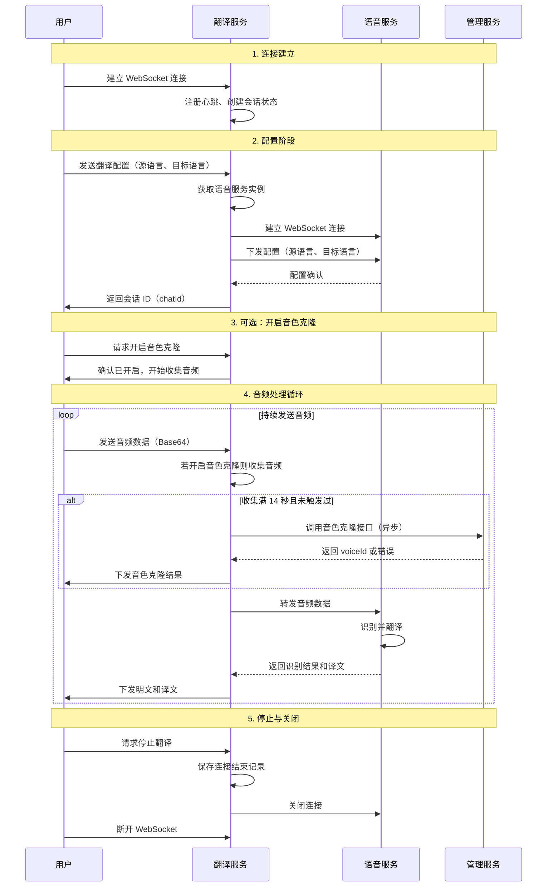
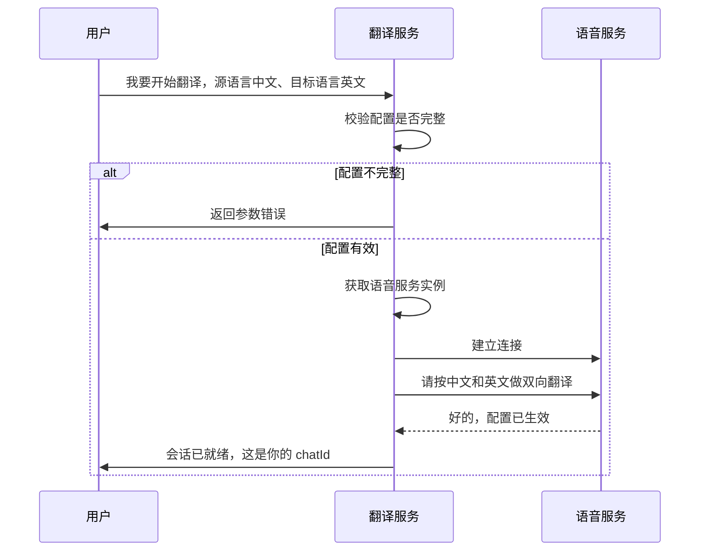
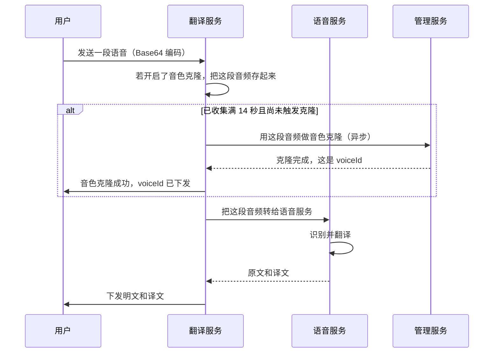
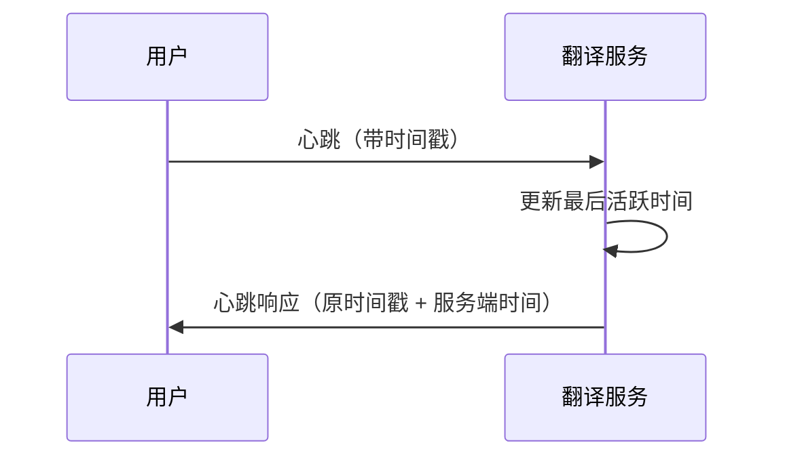
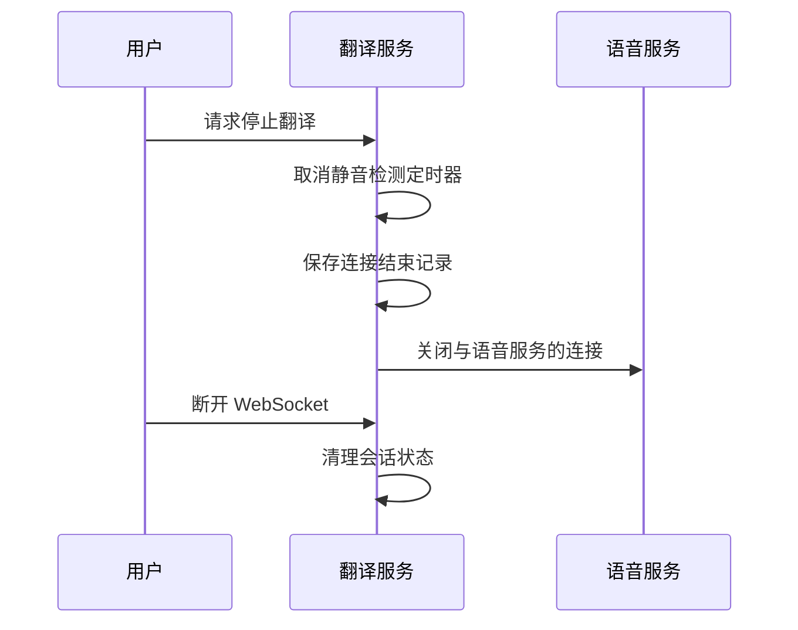

# 翻译场景 WebSocket 时序图

## 一、主要对象说明

| 对象 | 说明 |
|------|------|
| **用户** | 客户端（App/Web），发起 WebSocket 连接并发送各类请求 |
| **翻译服务** | 本服务整体，作为单一对象处理所有业务逻辑（包括会话管理、音频转发、持久化等） |
| **语音服务** | hojoai-webmvc-omniasst-voice，负责 ASR 识别和实时翻译 |
| **管理服务** | hojoai-webmvc-omniasst-management，负责音色克隆接口 |

说明：TranslationPersistenceService、VoiceServiceWebSocketClient 等均为翻译服务内部组件，不单独作为时序图对象。

---

## 二、完整生命周期时序图

从连接建立到关闭的完整交互流程：

**1. 连接建立**：用户建立 WebSocket 连接后，翻译服务注册心跳并创建会话状态。

**2. 配置阶段**：用户下发源语言和目标语言；翻译服务连接语音服务并下发配置，收到确认后生成 chatId 并返回给用户。配置完成前无法处理音频。

**3. 音色克隆（可选）**：用户可请求开启音色克隆，翻译服务开始收集音频，收集满 14 秒后异步调用管理服务完成克隆并下发音色 ID。

**4. 音频处理循环**：用户持续发送 Base64 音频；翻译服务透传至语音服务，语音服务识别并翻译后回传；翻译服务将原文和译文下发给用户。若开启音色克隆，则在收集满 14 秒时触发克隆。

**5. 停止与关闭**：用户请求停止后，翻译服务保存结束记录、关闭与语音服务的连接；用户断开 WebSocket，翻译服务清理会话。

---

## 三、配置阶段时序图（自然语言版）

用户发起配置请求，翻译服务完成初始化并返回会话 ID：

---

## 四、音频处理与音色克隆时序图（自然语言版）

用户持续发送音频，翻译服务转发给语音服务并可能触发音色克隆：

---

## 五、心跳时序图

客户端每 10 秒发送一次心跳，保持连接活跃：

---

## 六、停止与关闭时序图

用户主动停止翻译或断开连接时的处理流程：

---

## 七、关键交互点对照

| 用户请求 | 翻译服务行为 | 涉及第三方 |
|----------|--------------|------------|
| 建立连接 | 注册心跳、创建 SessionState | 无 |
| REQ_ASR_TRANSLATE_CONFIG | 获取语音服务实例 → 连语音服务 → 发配置 → 生成 chatId | 语音服务 |
| REQ_HEARTBEAT | 更新活跃时间，原样回传 | 无 |
| REQ_VOICE_CLONE_ENABLE | 开启收集，返回确认 | 无 |
| REQ_TRANSLATE_AUDIO_DATA | 收集音频、可能触发克隆、转发音频、处理结果 | 语音服务、管理服务（音色克隆） |
| REQ_TRANSLATE_STOP | 保存结束记录、关闭语音连接 | 无 |
| 断开连接 | 清理会话、关闭语音连接 | 无 |

---

## 八、补充说明

1. **静音检测**：翻译服务内部定时（每 200ms 检查）向语音服务发送静音包，用于在用户停止说话时触发句子结束。此逻辑属于翻译服务内部行为，不单独展示于时序图。

2. **持久化**：翻译服务在句子结束（isEnd=1）或连接关闭时，会调用内部持久化逻辑保存翻译结果，不涉及外部第三方服务作为时序图参与者。

3. **音色克隆时长**：代码中 `VOICE_CLONE_MIN_DURATION_MS = 14 * 1000`（14 秒），即收集满 14 秒有效音频后才触发音色克隆。
