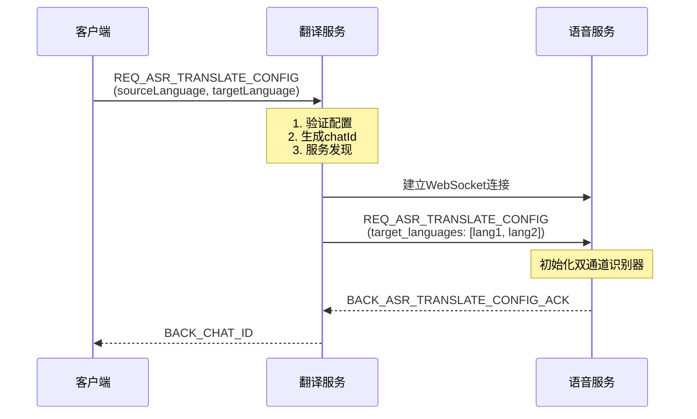
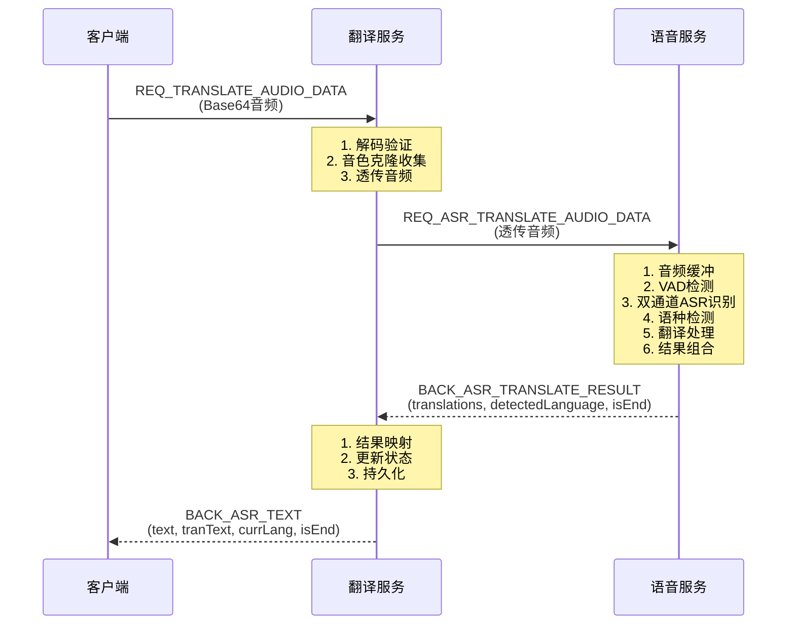

# 语音服务与翻译服务职责划分说明

## 一、概述

系统采用**微服务架构**，将语音处理和业务逻辑分离：
- **语音服务**（hojoai-webmvc-omniasst-voice）：专注于音频处理和AI能力
- **翻译服务**（hojoai-webmvc-omniasst-translate）：专注于业务逻辑和会话管理

## 二、服务职责对比表

| 职责项 | 翻译服务 | 语音服务 |
|--------|---------|---------|
| **WebSocket连接管理** | ✅ 管理客户端连接 | ✅ 管理与翻译服务的连接 |
| **会话状态管理** | ✅ 管理会话状态（SessionState） | ❌ 不管理业务会话 |
| **配置管理** | ✅ 接收客户端配置，转发给语音服务 | ✅ 接收配置，初始化识别器 |
| **音频处理** | ❌ 不处理音频（透传） | ✅ 音频缓冲、VAD、ASR、翻译 |
| **ASR识别** | ❌ 不进行识别 | ✅ 双通道ASR识别 |
| **翻译处理** | ❌ 不进行翻译 | ✅ 文本翻译 |
| **语种检测** | ❌ 不检测语种 | ✅ 自动检测语种 |
| **结果映射** | ✅ 根据检测语言映射结果 | ❌ 返回原始结果 |
| **数据持久化** | ✅ 保存翻译结果到数据库 | ❌ 不持久化数据 |
| **音色克隆** | ✅ 收集音频，调用管理服务 | ❌ 不处理音色克隆 |
| **心跳管理** | ✅ 管理客户端心跳 | ❌ 不管理心跳 |
| **错误处理** | ✅ 业务错误处理 | ✅ 音频处理错误处理 |
| **服务发现** | ✅ 通过Nacos发现语音服务 | ❌ 不进行服务发现 |

## 三、翻译服务职责详解

### 3.1 核心职责

翻译服务（`TranslateWebSocketHandler`）主要负责：

#### ✅ 1. 客户端连接管理
- 建立和管理与客户端的 WebSocket 连接
- 处理客户端的心跳消息
- 管理连接生命周期（建立、关闭、错误处理）

```java
// 连接建立
afterConnectionEstablished(WebSocketSession session)
// 连接关闭
afterConnectionClosed(WebSocketSession session, CloseStatus closeStatus)
```

#### ✅ 2. 会话状态管理
- 为每个连接维护 `SessionState` 对象
- 存储会话相关信息：
  - `chatId`: 会话ID（雪花算法生成）
  - `sourceLanguage/targetLanguage`: 源/目标语言配置
  - `asrText/transText`: 识别的原文和译文
  - `detectedLang`: 检测到的语言
  - `voiceCloneEnabled`: 音色克隆状态
  - `connectionStartTime`: 连接开始时间

```java
private static class SessionState {
    String chatId;
    String sourceLanguage;
    String targetLanguage;
    long connectionStartTime;
    VoiceServiceWebSocketClient voiceClient;
    String asrText = "";
    String transText = "";
    String detectedLang;
    // ...
}
```

#### ✅ 3. 服务发现与连接
- 通过 Nacos 服务发现获取语音服务实例
- 建立与语音服务的 WebSocket 连接
- 管理 `VoiceServiceWebSocketClient` 生命周期

```java
Instance instance = namingService.selectOneHealthyInstance("hojoai-webmvc-omniasst-voice");
String voiceServiceWsUrl = String.format("ws://%s:%d/omniasst-voice/asr/translate", 
    instance.getIp(), instance.getPort());
state.voiceClient = new VoiceServiceWebSocketClient(voiceServiceWsUrl, ...);
```

#### ✅ 4. 音频数据透传
- **不进行任何音频处理**（包括VAD检测）
- 接收客户端的 Base64 编码音频
- 直接透传给语音服务

```java
// 解码Base64（仅用于验证和音色克隆收集）
byte[] audioBytes = Base64.getDecoder().decode(request.getAudioData());
// 透传给语音服务（原始Base64字符串）
state.voiceClient.sendAudioData(request.getAudioData());
```

#### ✅ 5. 结果映射与转换
- 接收语音服务的双通道识别结果
- 根据 `detectedLanguage` 和配置的 `sourceLanguage/targetLanguage` 进行结果映射
- 确定原文（asrText）和译文（transText）

```java
// 语音服务返回：translations = {"chinese": "你好", "english": "Hello"}
// detectedLanguage = "chinese"

if (detectedLanguage.equals(state.sourceLanguage)) {
    // 正常翻译：原文=源语言，译文=目标语言
    state.asrText = "你好";
    state.transText = "Hello";
} else if (detectedLanguage.equals(state.targetLanguage)) {
    // 反向翻译：原文=目标语言，译文=源语言
    state.asrText = "Hello";
    state.transText = "你好";
}
```

#### ✅ 6. 数据持久化
- 保存翻译结果到数据库
- 管理翻译会话（TranslationConversation）
- 管理翻译消息（TranslationMessage）
- 生成会话标题和摘要（异步，使用LLM）

```java
// 句子结束时保存
translationPersistenceService.persistTranslateResult(message);

// 连接结束时更新会话状态
publishTranslateConnectionEnd(session, state, endTime);
```

#### ✅ 7. 音色克隆业务逻辑
- 收集音频数据（当启用音色克隆时）
- 累计音频时长（达到5秒后触发）
- 异步调用管理服务的音色克隆接口
- 返回音色克隆结果给客户端

```java
// 收集音频
collectVoiceCloneAudio(state, audioBytes);

// 触发条件：时长 >= 5秒
if (state.voiceCloneAudioDurationMs >= VOICE_CLONE_MIN_DURATION_MS) {
    triggerVoiceClone(session, state);  // 异步执行
}
```

#### ✅ 8. 心跳管理
- 注册会话到心跳管理器
- 更新最后活跃时间
- 处理客户端心跳消息

```java
heartbeatManager.registerSession(session, "TranslateWebSocketHandler");
heartbeatManager.updateLastActiveTime(session);
```

#### ✅ 9. 错误处理与响应
- 处理业务层面的错误
- 格式化错误响应
- 返回错误信息给客户端

```java
sendError(session, "CONFIG_ERROR", "Configuration not found", "config");
```

### 3.2 翻译服务不处理的

- ❌ **音频处理**：不进行VAD检测、音频格式转换等
- ❌ **ASR识别**：不进行语音识别
- ❌ **翻译处理**：不进行文本翻译
- ❌ **语种检测**：不检测用户说话的语言

## 四、语音服务职责详解

### 4.1 核心职责

语音服务（hojoai-webmvc-omniasst-voice）主要负责：

#### ✅ 1. 音频处理
- 接收音频数据（Base64编码）
- 音频缓冲区管理
- 音频格式验证和处理

#### ✅ 2. VAD（语音活动检测）
- 检测音频中的有效语音段
- 过滤静音和噪声
- 确定语音开始和结束

> **注意**：在WebSocket实时翻译流程中，VAD可能在语音服务内部处理，也可能由客户端处理。

#### ✅ 3. ASR（自动语音识别）
- **双通道并行识别**：
  - 通道1：识别源语言（如chinese）
  - 通道2：识别目标语言（如english）
- 实时流式识别
- 识别结果累积和更新

```java
// 语音服务内部处理
// 通道1: ASR识别 chinese → "你好"
// 通道2: ASR识别 english → ""
```

#### ✅ 4. 语种检测
- 根据双通道识别结果判断用户说的语言
- 如果通道1有结果 → `detectedLanguage = sourceLanguage`
- 如果通道2有结果 → `detectedLanguage = targetLanguage`

```java
// 返回结果
{
  "detected_language": "chinese",  // 根据哪个通道有结果判断
  "translations": {
    "chinese": "你好",
    "english": "Hello"
  }
}
```

#### ✅ 5. 翻译处理
- 根据检测到的语言进行翻译
- 如果检测到源语言 → 翻译到目标语言
- 如果检测到目标语言 → 翻译到源语言（反向翻译）

```java
// 语音服务内部处理
// detectedLanguage = "chinese"
// 翻译: "你好" → "Hello"
```

#### ✅ 6. 结果组合
- 组合ASR识别结果和翻译结果
- 返回 `translations` Map，包含两种语言的文本

```java
// 返回格式
{
  "translations": {
    "chinese": "你好",      // ASR识别结果
    "english": "Hello"      // 翻译结果
  },
  "detected_language": "chinese",
  "is_end": 0
}
```

#### ✅ 7. 与翻译服务的WebSocket通信
- 接收翻译服务转发的配置
- 接收翻译服务转发的音频数据
- 返回识别和翻译结果

### 4.2 语音服务不处理的

- ❌ **业务逻辑**：不处理业务会话、用户管理等
- ❌ **数据持久化**：不保存翻译结果到数据库
- ❌ **服务发现**：不进行服务发现
- ❌ **结果映射**：返回原始的双通道结果，不进行业务映射
- ❌ **音色克隆**：不处理音色克隆业务

## 五、服务交互流程

### 5.1 配置阶段



**职责划分**：
- **翻译服务**：配置验证、chatId生成、服务发现、连接管理
- **语音服务**：识别器初始化、配置确认

### 5.2 音频处理阶段



**职责划分**：
- **翻译服务**：音频透传、结果映射、状态管理、数据持久化
- **语音服务**：音频处理、VAD、ASR、翻译、语种检测

### 5.3 结果处理对比

| 处理项 | 翻译服务 | 语音服务 |
|--------|---------|---------|
| **输入** | 客户端音频（Base64） | 翻译服务转发的音频 |
| **处理** | 透传 + 结果映射 | ASR + 翻译 + 语种检测 |
| **输出** | 映射后的结果（text, tranText） | 双通道结果（translations Map） |

## 六、数据流转对比

### 6.1 翻译服务的数据流转

```
客户端请求
  ↓
配置验证、状态管理
  ↓
服务发现、连接管理
  ↓
音频透传（不处理）
  ↓
结果映射（业务逻辑）
  ↓
数据持久化
  ↓
返回给客户端
```

### 6.2 语音服务的数据流转

```
翻译服务转发的音频
  ↓
音频缓冲
  ↓
VAD检测（可选）
  ↓
双通道ASR识别
  ↓
语种检测
  ↓
翻译处理
  ↓
结果组合
  ↓
返回给翻译服务
```

## 七、关键设计原则

### 7.1 职责分离（Separation of Concerns）

- **翻译服务**：专注业务逻辑、会话管理、数据持久化
- **语音服务**：专注音频处理、AI能力（ASR、翻译）

### 7.2 单一职责原则（Single Responsibility Principle）

- 每个服务只负责一个明确的职责领域
- 避免服务之间的职责重叠

### 7.3 服务解耦

- 通过 WebSocket 进行异步通信
- 通过 Nacos 进行服务发现，实现动态路由
- 服务之间不直接依赖数据库或共享状态

## 八、总结

### 8.1 翻译服务 = 业务服务

**核心定位**：业务逻辑编排、会话管理、数据持久化

**关键能力**：
- ✅ WebSocket连接管理
- ✅ 会话状态管理
- ✅ 服务发现与路由
- ✅ 结果映射与转换
- ✅ 数据持久化
- ✅ 音色克隆业务逻辑

### 8.2 语音服务 = AI能力服务

**核心定位**：音频处理、AI能力提供

**关键能力**：
- ✅ 音频处理
- ✅ VAD检测
- ✅ ASR识别（双通道）
- ✅ 语种检测
- ✅ 文本翻译

### 8.3 协作模式

```
客户端 ←→ 翻译服务（业务层） ←→ 语音服务（AI层）
         ↑                    ↑
      业务逻辑               AI能力
      会话管理               音频处理
      数据持久化             识别翻译
```

这种架构设计的优势：
1. **职责清晰**：每个服务专注自己的领域
2. **易于扩展**：可以独立扩展AI能力或业务功能
3. **易于维护**：问题定位更准确
4. **资源优化**：可以针对不同服务进行资源优化
