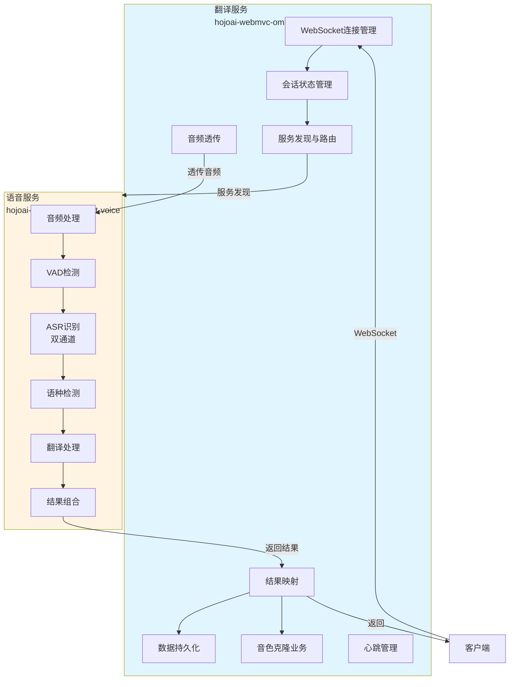
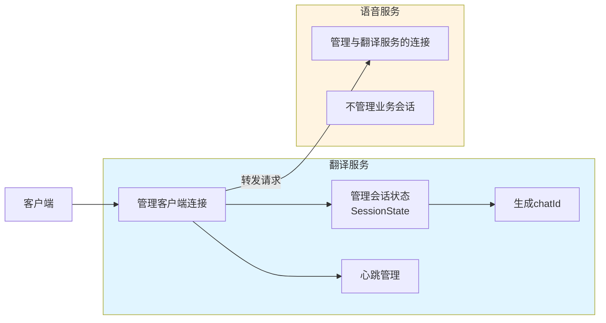
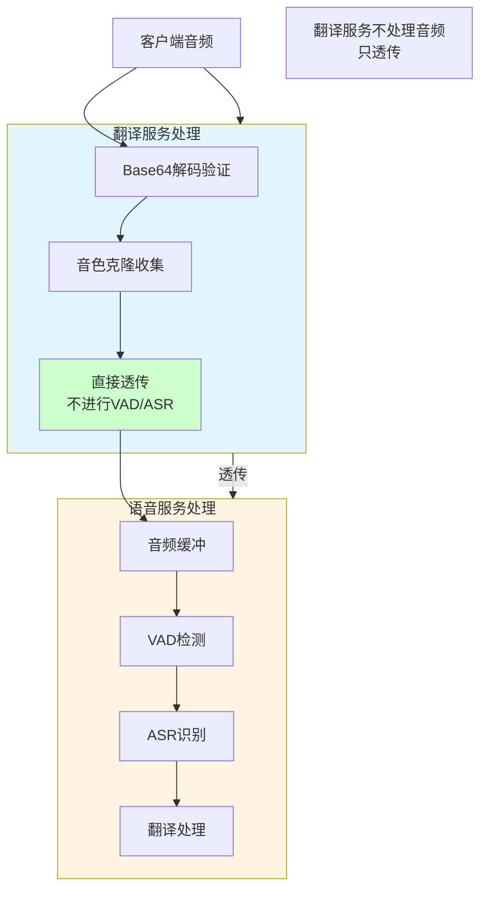
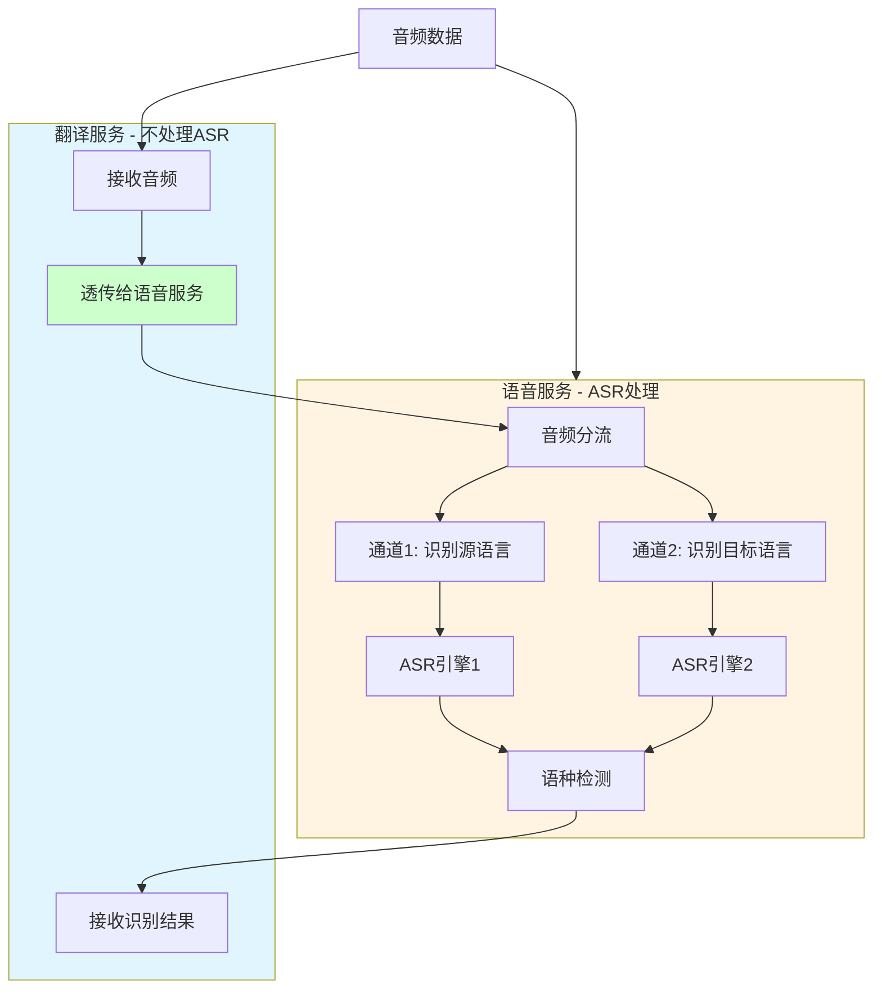
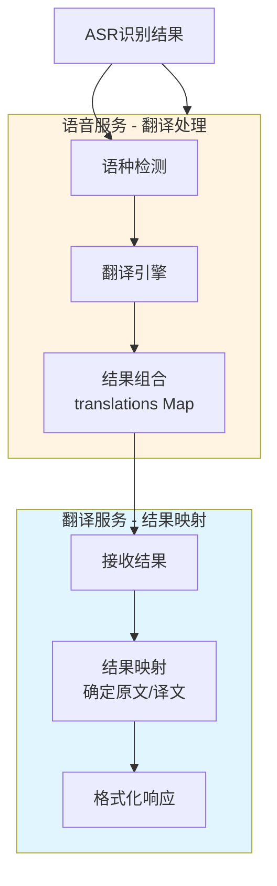
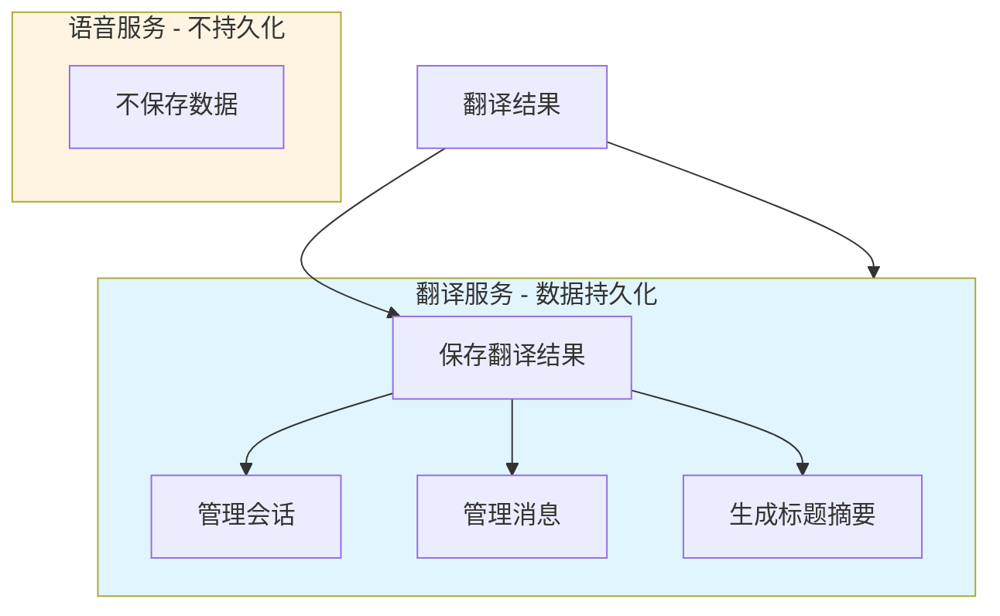
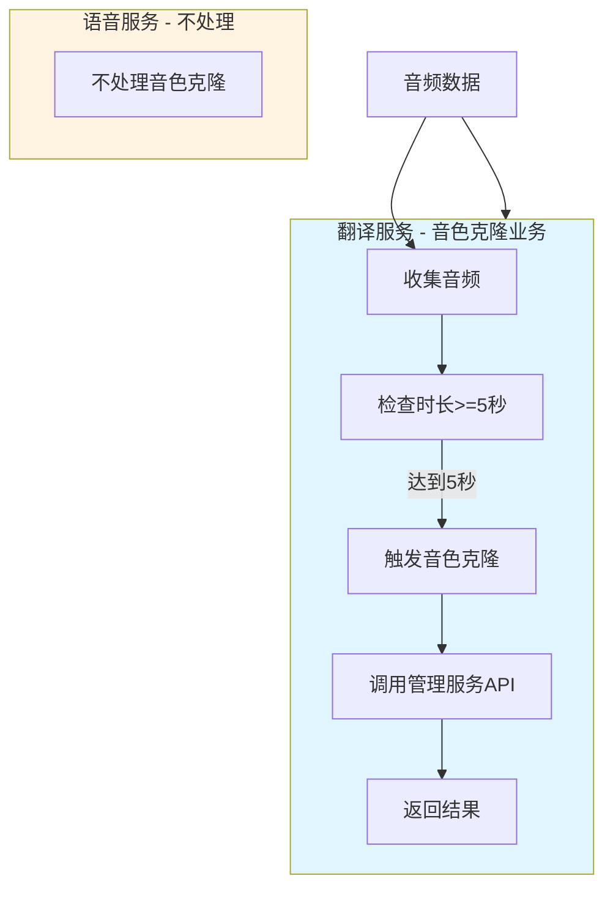
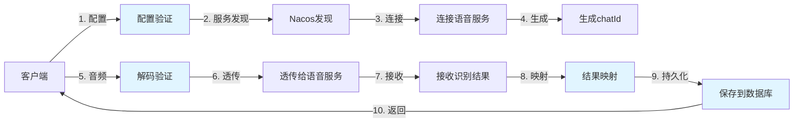
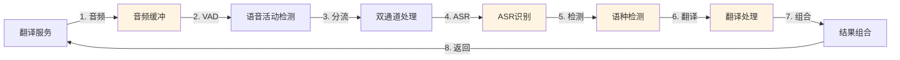
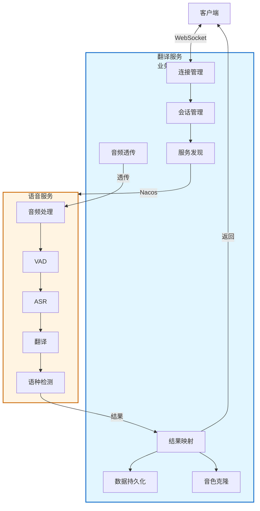

# 语音服务与翻译服务职责对比图

## 一、职责对比总览

## 二、详细职责对比

### 2.1 连接与会话管理

**对比**：
- **翻译服务**：✅ 完整的连接和会话管理
- **语音服务**：✅ 仅管理与翻译服务的连接，不管理业务会话

### 2.2 音频处理

**对比**：
- **翻译服务**：❌ 不进行音频处理（VAD、ASR等），只透传
- **语音服务**：✅ 完整的音频处理流程（缓冲、VAD、ASR、翻译）

### 2.3 ASR识别

**对比**：
- **翻译服务**：❌ 不进行ASR识别，只透传音频
- **语音服务**：✅ 双通道并行ASR识别

### 2.4 翻译处理

**对比**：
- **翻译服务**：❌ 不进行翻译，只进行结果映射
- **语音服务**：✅ 进行文本翻译处理

### 2.5 数据持久化

**对比**：
- **翻译服务**：✅ 完整的数据持久化（数据库、会话、消息）
- **语音服务**：❌ 不进行数据持久化

### 2.6 音色克隆

**对比**：
- **翻译服务**：✅ 音色克隆业务逻辑（收集、触发、调用API）
- **语音服务**：❌ 不处理音色克隆

## 三、数据流转对比

### 3.1 翻译服务数据流

### 3.2 语音服务数据流

## 四、处理能力对比矩阵

| 处理能力 | 翻译服务 | 语音服务 | 说明 |
|---------|---------|---------|------|
| **WebSocket连接** | ✅ 客户端 | ✅ 翻译服务 | 各自管理自己的连接 |
| **会话管理** | ✅ | ❌ | 翻译服务管理业务会话 |
| **服务发现** | ✅ | ❌ | 翻译服务通过Nacos发现语音服务 |
| **配置管理** | ✅ 接收+转发 | ✅ 接收+初始化 | 翻译服务接收，语音服务处理 |
| **音频处理** | ❌ 透传 | ✅ 完整处理 | 翻译服务不处理音频 |
| **VAD检测** | ❌ | ✅ | 语音服务处理 |
| **ASR识别** | ❌ | ✅ 双通道 | 语音服务处理 |
| **语种检测** | ❌ | ✅ | 语音服务处理 |
| **翻译处理** | ❌ | ✅ | 语音服务处理 |
| **结果映射** | ✅ | ❌ | 翻译服务根据业务逻辑映射 |
| **数据持久化** | ✅ | ❌ | 翻译服务保存到数据库 |
| **音色克隆** | ✅ 业务逻辑 | ❌ | 翻译服务处理业务逻辑 |
| **心跳管理** | ✅ | ❌ | 翻译服务管理客户端心跳 |
| **错误处理** | ✅ 业务错误 | ✅ 处理错误 | 各自处理自己领域的错误 |

## 五、一句话总结

- **翻译服务**：业务编排者，管理会话、透传数据、映射结果、持久化数据
- **语音服务**：AI能力提供者，处理音频、识别语音、翻译文本

## 六、协作模式图

**核心原则**：
- 翻译服务 = **编排者**（Orchestrator）
- 语音服务 = **执行者**（Executor）
