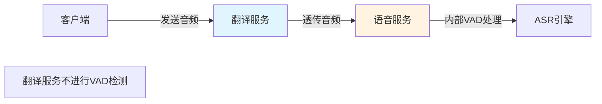
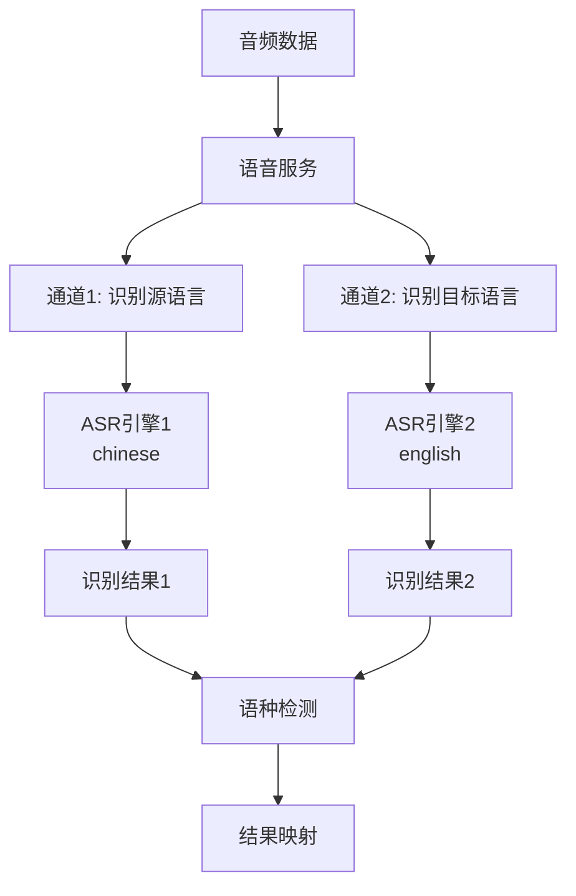
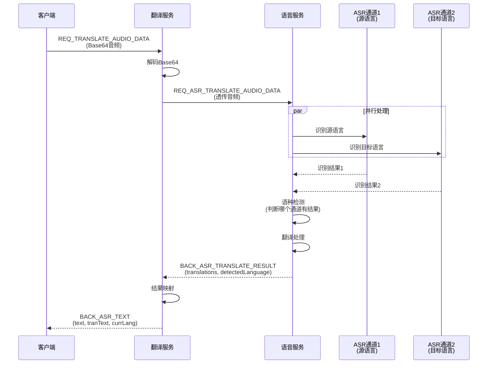
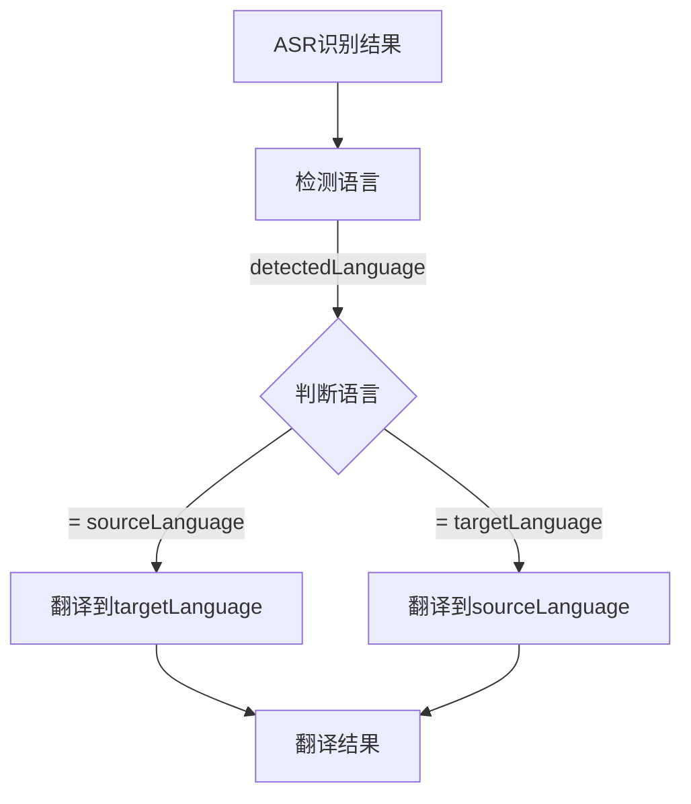
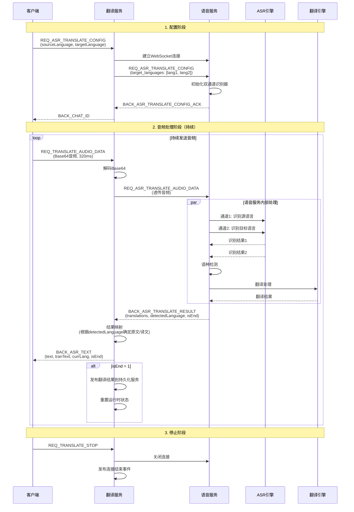
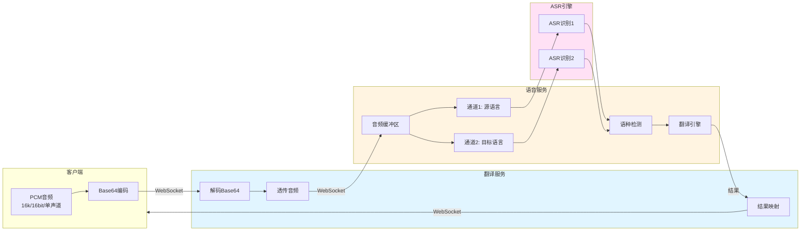

# 语音翻译完整链路说明

## 一、概述

本文档详细说明语音翻译服务中 **VAD（语音活动检测）**、**ASR（自动语音识别）** 和 **翻译** 的完整处理链路。

## 二、架构概览

```
客户端
  ↓ (WebSocket)
翻译服务 (TranslateWebSocketHandler)
  ↓ (WebSocket)
语音服务 (hojoai-webmvc-omniasst-voice)
  ↓ (内部处理)
ASR引擎 + 翻译引擎
```

## 三、VAD（语音活动检测）处理

### 3.1 VAD 在翻译流程中的位置

**重要说明**：在 WebSocket 翻译流程中，**翻译服务不做 VAD 检测**，音频数据直接透传给语音服务。



### 3.2 VAD 相关接口

虽然代码中定义了 VAD 相关的接口（`VoiceBaseServiceClient.vad()`），但在 WebSocket 实时翻译流程中不使用，这些接口可能用于其他场景（如批量处理）。

**VAD 接口定义**：
```java
@PostMapping(value = "/v1/vad")
Response<VADResponse> vad(@RequestBody VADRequest request);
```

**VAD 请求参数**：
- `vid`: 会话ID
- `packageSize`: 包大小
- `packageData`: Base64编码的音频数据
- `vadEnd`: VAD结束标志
- `vadDrop`: VAD丢弃标志

### 3.3 VAD 处理位置

VAD 检测可能在以下位置进行：
1. **客户端**：在发送音频前进行VAD检测，只发送有效语音段
2. **语音服务内部**：语音服务接收音频后，内部进行VAD处理

## 四、ASR（自动语音识别）处理

### 4.1 双通道识别机制

语音服务采用**双通道识别**机制，同时识别源语言和目标语言：



### 4.2 配置阶段

在配置阶段，翻译服务会告诉语音服务需要识别的语言对：

```java
// TranslateWebSocketHandler.handleConfig()
Map<String, Object> config = Map.of(
    "provider", "azure",
    "target_languages", List.of(lang1, lang2)  // 例如: ["chinese", "english"]
);
```

**配置流程**：
1. 客户端发送配置：`sourceLanguage` 和 `targetLanguage`
2. 翻译服务从 Nacos 获取语音服务实例
3. 建立与语音服务的 WebSocket 连接
4. 发送配置：`target_languages: [sourceLanguage, targetLanguage]`
5. 语音服务初始化双通道识别器

### 4.3 音频数据流转



### 4.4 音频数据格式

- **原始格式**：PCM，16kHz，16bit，单声道
- **传输格式**：Base64 编码字符串
- **包大小**：建议 10240 字节（约 320ms）
- **传输方式**：WebSocket 文本消息

## 五、翻译处理

### 5.1 翻译流程

翻译在语音服务内部完成，与 ASR 并行或串行处理：



### 5.2 结果数据结构

语音服务返回的结果格式：

```json
{
  "event": "BACK_ASR_TRANSLATE_RESULT",
  "payload": {
    "pdata": {
      "translations": {
        "chinese": "你好，这是一段测试文本",
        "english": "Hello, this is a test text"
      },
      "detected_language": "chinese",
      "is_end": 0
    }
  }
}
```

**关键字段**：
- `translations`: Map<String, String>，包含两种语言的识别和翻译结果
- `detected_language`: 检测到的用户说话语言
- `is_end`: 0=未结束，1=句子结束

### 5.3 结果映射逻辑

翻译服务根据 `detected_language` 和配置的 `sourceLanguage`/`targetLanguage` 进行结果映射：

```java
// TranslateWebSocketHandler.handleVoiceServiceResult()

String sourceLangText = translations.get(state.sourceLanguage);  // 例如: "你好"
String targetLangText = translations.get(state.targetLanguage);  // 例如: "Hello"

if (detectedLanguage.equals(state.sourceLanguage)) {
    // 用户说源语言，原文=源语言文本，译文=目标语言文本
    state.asrText = sourceLangText;      // "你好"
    state.transText = targetLangText;    // "Hello"
} else if (detectedLanguage.equals(state.targetLanguage)) {
    // 用户说目标语言，原文=目标语言文本，译文=源语言文本（反向翻译）
    state.asrText = targetLangText;     // "Hello"
    state.transText = sourceLangText;    // "你好"
}
```

**映射示例**：

| 配置 | 检测语言 | translations | 映射结果 |
|------|---------|-------------|---------|
| source: chinese<br/>target: english | chinese | chinese: "你好"<br/>english: "Hello" | asrText: "你好"<br/>transText: "Hello" |
| source: chinese<br/>target: english | english | chinese: "你好"<br/>english: "Hello" | asrText: "Hello"<br/>transText: "你好" |

## 六、完整处理链路

### 6.1 端到端流程图



### 6.2 数据流转图



## 七、关键设计点

### 7.1 双通道识别的优势

1. **自动语种检测**：无需用户指定说话语言，系统自动判断
2. **双向翻译**：支持源语言→目标语言和目标语言→源语言
3. **实时性**：两个通道并行处理，提高响应速度

### 7.2 音频透传设计

翻译服务不进行音频处理（包括VAD），直接透传：
- **优势**：减少延迟，降低服务负载
- **职责分离**：翻译服务专注于业务逻辑，语音服务专注于音频处理

### 7.3 结果映射机制

根据检测到的语言动态确定原文和译文：
- 如果用户说源语言 → 正常翻译（源→目标）
- 如果用户说目标语言 → 反向翻译（目标→源）

这样实现了**双向实时翻译**功能。

## 八、性能优化

### 8.1 音频包大小

- **建议包大小**：10240 字节（约 320ms）
- **原因**：平衡延迟和网络效率
- **太小**：网络开销大，延迟高
- **太大**：实时性差，用户体验不好

### 8.2 并行处理

- **双通道识别**：并行处理，提高吞吐量
- **异步音色克隆**：不阻塞音频处理流程

### 8.3 状态管理

- **运行时状态重置**：句子结束时重置，避免状态污染
- **会话隔离**：每个连接独立状态，支持并发

## 九、错误处理

### 9.1 各阶段错误

| 阶段 | 错误代码 | 说明 |
|------|---------|------|
| 配置 | CONFIG_ERROR | 配置参数错误或缺失 |
| ASR | ASR_ERROR | ASR识别失败 |
| 翻译 | TRANSLATE_ERROR | 翻译服务错误 |
| 处理 | PROCESS_ERROR | 处理过程异常 |

### 9.2 错误传播

```
语音服务错误 → VoiceServiceWebSocketClient.onError()
  ↓
翻译服务错误处理 → sendError()
  ↓
返回给客户端 → BACK_ERROR
```

## 十、总结

### 10.1 处理链路总结

1. **VAD**：翻译服务不做VAD，音频直接透传
2. **ASR**：语音服务双通道并行识别
3. **翻译**：语音服务内部完成，与ASR结果一起返回
4. **映射**：翻译服务根据检测语言确定原文/译文

### 10.2 关键特性

- ✅ **双向翻译**：自动检测语言，支持双向
- ✅ **实时处理**：流式处理，低延迟
- ✅ **自动语种检测**：无需用户指定
- ✅ **职责分离**：翻译服务专注业务，语音服务专注音频
