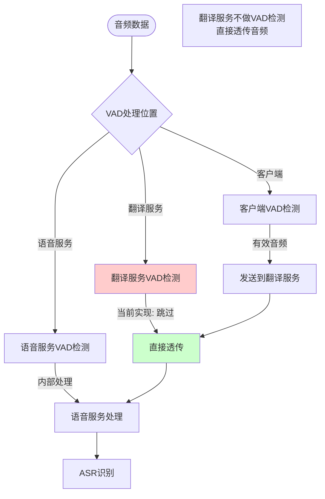
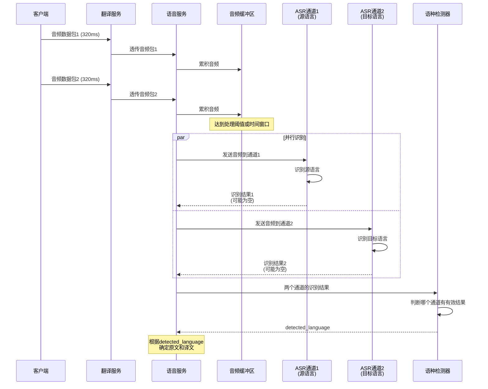
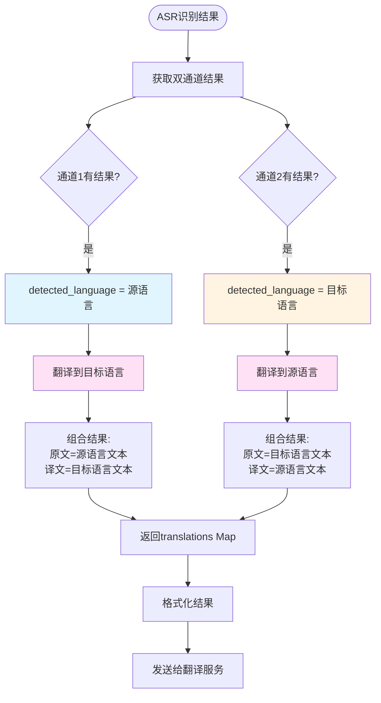
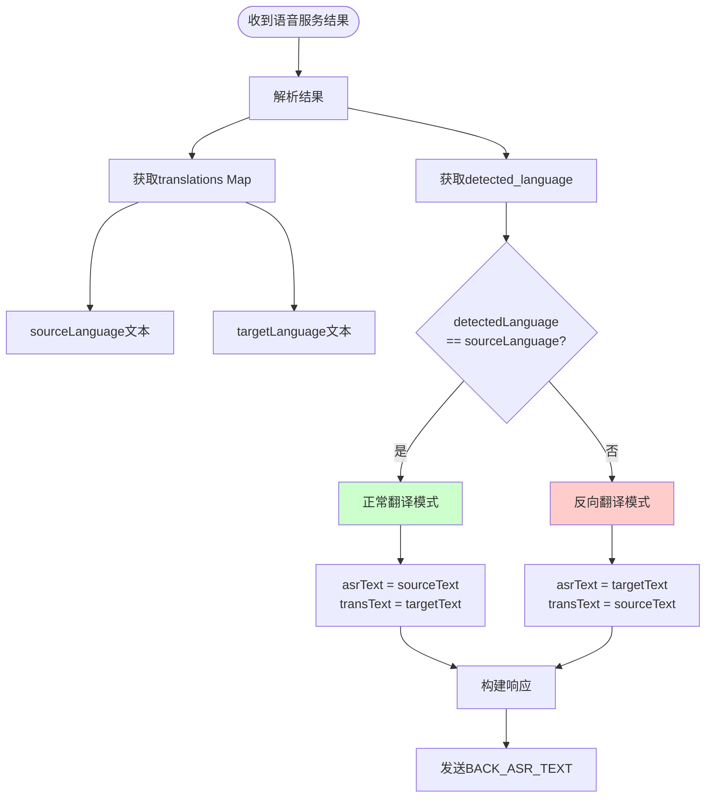
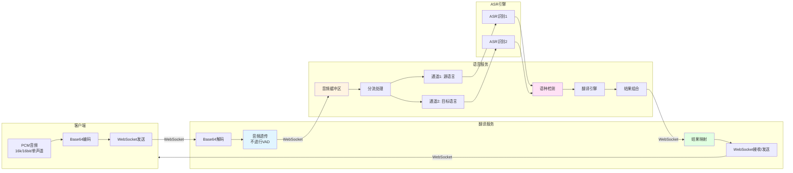
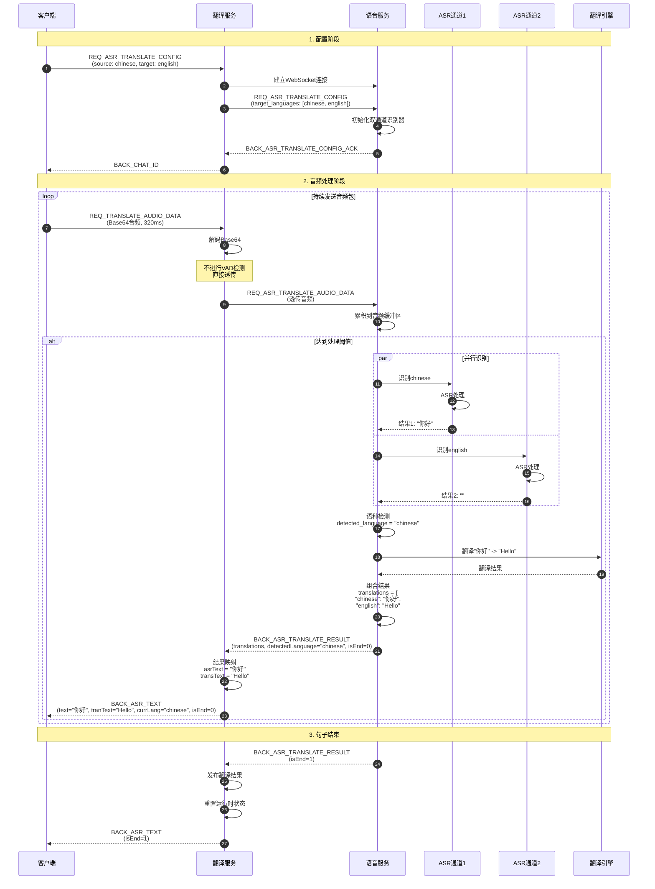
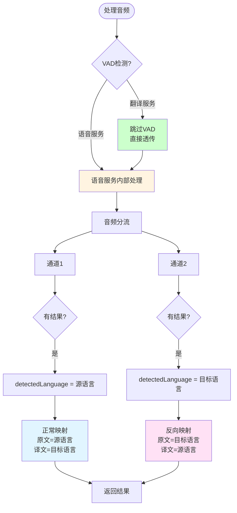
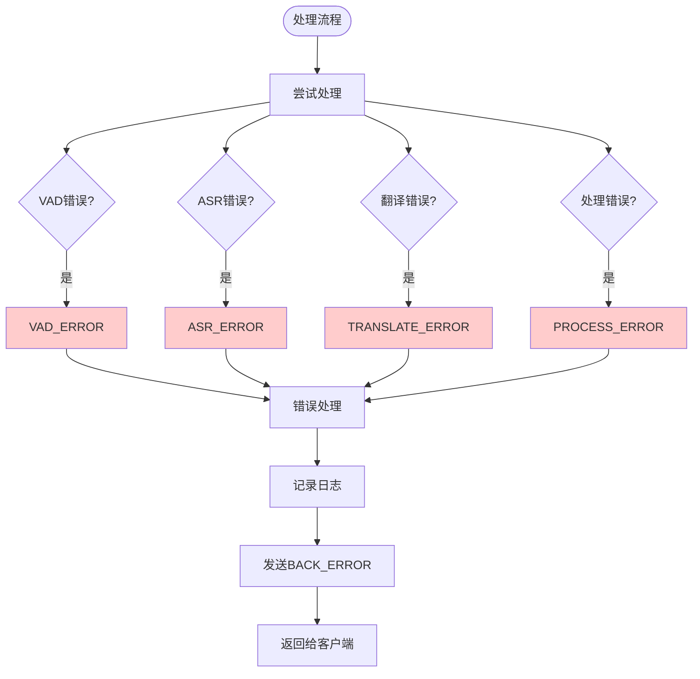
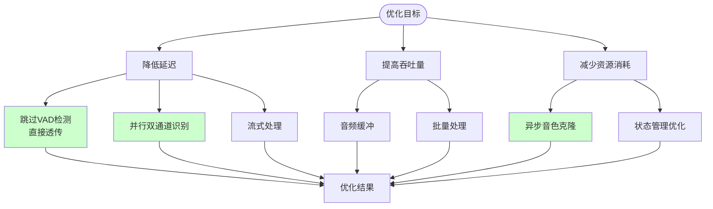

# 语音翻译链路流程图

## 一、完整链路流程图

```mermaid
graph TB
    Start([客户端开始]) --> Connect[建立WebSocket连接]
    Connect --> Config[发送配置<br/>REQ_ASR_TRANSLATE_CONFIG]
    
    Config --> GetNacos[从Nacos获取语音服务实例]
    GetNacos --> ConnectVoice[连接语音服务WebSocket]
    ConnectVoice --> SendConfig[发送配置到语音服务<br/>target_languages: [lang1, lang2]]
    SendConfig --> InitChannels[语音服务初始化双通道]
    InitChannels --> ReturnChatId[返回chatId给客户端]
    
    ReturnChatId --> AudioLoop[开始音频处理循环]
    
    AudioLoop --> ReceiveAudio[接收音频数据<br/>REQ_TRANSLATE_AUDIO_DATA]
    ReceiveAudio --> Decode[解码Base64音频]
    Decode --> Forward[透传音频到语音服务<br/>不进行VAD检测]
    
    Forward --> VoiceBuffer[语音服务音频缓冲区]
    VoiceBuffer --> Split[音频分流]
    
    Split --> Channel1[通道1: 识别源语言]
    Split --> Channel2[通道2: 识别目标语言]
    
    Channel1 --> ASR1[ASR引擎1<br/>识别源语言]
    Channel2 --> ASR2[ASR引擎2<br/>识别目标语言]
    
    ASR1 --> Result1[识别结果1]
    ASR2 --> Result2[识别结果2]
    
    Result1 --> Detect[语种检测<br/>判断哪个通道有结果]
    Result2 --> Detect
    
    Detect --> Translate[翻译引擎<br/>根据检测语言翻译]
    Translate --> Combine[组合结果<br/>translations Map]
    
    Combine --> ReturnResult[返回结果<br/>BACK_ASR_TRANSLATE_RESULT]
    ReturnResult --> Map[结果映射<br/>确定原文/译文]
    
    Map --> SendClient[发送给客户端<br/>BACK_ASR_TEXT]
    SendClient --> CheckEnd{isEnd=1?}
    
    CheckEnd -->|否| AudioLoop
    CheckEnd -->|是| Publish[发布翻译结果]
    Publish --> Reset[重置运行时状态]
    Reset --> AudioLoop
    
    AudioLoop --> Stop{停止?}
    Stop -->|否| AudioLoop
    Stop -->|是| Close[关闭连接]
    Close --> End([结束])
    
    style Forward fill:#e1f5ff
    style VoiceBuffer fill:#fff4e1
    style Detect fill:#ffe1f5
    style Map fill:#e1ffe1
```

## 二、VAD处理流程



## 三、ASR双通道识别流程



## 四、翻译处理流程



## 五、结果映射流程



## 六、端到端数据流



## 七、时序图：完整处理流程



## 八、关键决策点



## 九、错误处理流程



## 十、性能优化点


